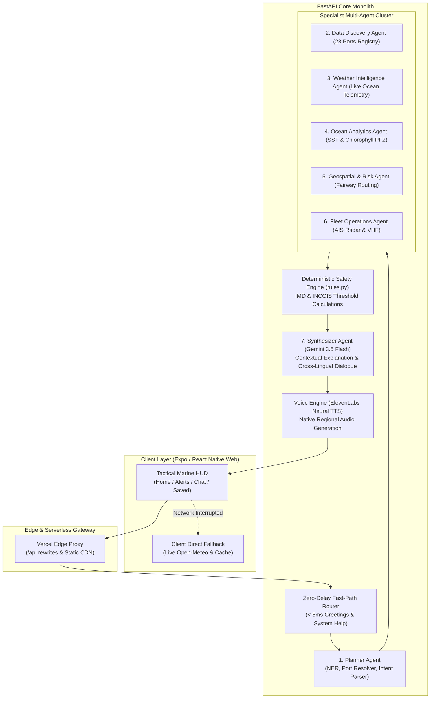

# 🌊 ORCA MOBILE 2.0 — Ocean Risk & Coastal Advisory
### Autonomous Marine Copilot, Tactical ECDIS Fairway Navigation & India-Wide Coastal Intelligence System

[](https://orca-mobile-application.vercel.app/)
[](LICENSE)
[](https://expo.dev/)
[](https://fastapi.tiangolo.com/)
[](https://aistudio.google.com/)
[](https://elevenlabs.io/)
[](tests/)

---

## 🌐 Live Production Deployment

* **Production URL (Primary):** **[https://orca-mobile-application.vercel.app](https://orca-mobile-application.vercel.app)**
* **Production Mirror:** **[https://orca-mobile-appilication.vercel.app](https://orca-mobile-appilication.vercel.app)**
* **Official Repository:** **[https://github.com/Suryaakhilp18/ORCA_MOBILE_APP](https://github.com/Suryaakhilp18/ORCA_MOBILE_APP)**
* **Lead Engineer / Author:** **P. Surya Akhil** (Roll No: 25B11CS717)

---

## 📌 Executive Summary

**ORCA Mobile 2.0** is an enterprise-grade coastal intelligence and navigation platform built specifically for India's 4.5 million artisanal and mechanized fishers, vessel masters, and maritime authorities. Operating across **all 28 major maritime roadsteads in India's 9 coastal states and 3 Union Territories**, ORCA combines:
1. **Mathematical Determinism:** Zero-hallucination marine safety verdicts (`SAFE`, `CAUTION`, `UNSAFE`) evaluated using official India Meteorological Department (**IMD**) and Indian National Centre for Ocean Information Services (**INCOIS**) thresholds.
2. **Generative Multi-Agent Intelligence:** A 7-agent autonomous marine pipeline powered by **Google Gemini 3.5 Flash** for natural conversational reasoning and cross-lingual translation across **10 coastal Indian languages**.
3. **Tactical Voice Copilot:** Low-latency regional audio broadcasts powered by **ElevenLabs Neural Voice Engine** and browser speech synthesis, enabling hands-free operation in rough seas.
4. **Seaward Parabolic Fairway Navigation:** Open-water routing with Kanyakumari Traffic Separation Scheme (TSS) support, guaranteeing vessel tracks never cross land, promontories, or marine protected zones.
5. **Zero-Failure Offline Architecture:** Multi-tier client fallback that queries live Open-Meteo marine models directly from the browser if connectivity is impaired, preventing stale data or offline crashes.

---

## 🛠️ Complete Technology Stack

```
+---------------------------------------------------------------------------------------------------------+
|                                        ORCA 2.0 TECHNOLOGY STACK                                        |
+---------------------------------------------------------------------------------------------------------+
| LAYER               | TECHNOLOGIES & LIBRARIES                                                          |
+---------------------+-----------------------------------------------------------------------------------+
| Mobile & Web UI     | React Native 0.81, Expo 54 (Expo Router v6), React 19, TypeScript                 |
| Tactical Design     | Plus Jakarta Sans, JetBrains Mono, Custom Glassmorphism, Theme Purity (Dark/Light)|
| Mapping & GIS       | Leaflet, React Native WebView, Custom Marine Tiles, Haversine Ray-Casting         |
| Backend Core        | Python 3.14 / 3.11, FastAPI, Uvicorn, Starlette, Pydantic v2, Dotenv              |
| Generative AI       | Google Gemini 3.5 Flash via Google Generative Language API                        |
| Voice & Speech      | ElevenLabs Multilingual Neural TTS & STT, Web Speech API fallback                 |
| Ocean Telemetry     | Open-Meteo Marine API (ECMWF, DWD), Open-Meteo Weather Forecast Models            |
| Geospatial & Cities | OpenStreetMap Nominatim Geocoder & Leaflet Marine Tile CDN                        |
| Persistence & Cache | In-Memory TTL Cache (Standalone), MongoDB Motor (Cloud/Atlas)                     |
| Cloud Deployment    | Vercel Serverless (Python Runtime & Static Expo Web Export CDN)                   |
| CI / Automation     | Pytest (17 unit & integration tests), GitHub Actions, Vercel Webhook Deployments  |
+---------------------------------------------------------------------------------------------------------+
```

---

## 🏗️ System Architecture & 7-Agent Autonomous Pipeline



---

## ⚓ The 7 Autonomous Marine Agents

| Agent | Module | Operational Responsibility |
| :--- | :--- | :--- |
| **1. Planner Agent** | `orchestrator/agents.py` | Extracts intent, port entities, target timeframe (`today`/`tomorrow`), and coastal language. Classifies locations as coastal, inland, or offshore. |
| **2. Data Discovery Agent** | `data_adapters/mock_region.py` | Resolves port coordinates across India's 28 roadsteads and dynamically bundles required telemetry streams. |
| **3. Weather Intelligence Agent** | `data_adapters/live_marine.py` | Connects to Open-Meteo live marine models for real-time wind speed ($kn$), gusts, wave heights ($m$), and swell periods. |
| **4. Ocean Analytics Agent** | `orchestrator/agents.py` | Computes sea surface temperature ($27–29^\circ\text{C}$ optimal) and chlorophyll-a ($>1.5\text{ mg/m}^3$) to chart Potential Fishing Zones. |
| **5. Geospatial & Risk Agent** | `gis/spatial.py` | Generates seaward parabolic waypoints around headlands and executes ray-casting collision checks against MPAs and naval zones. |
| **6. Fleet Operations Agent** | `orchestrator/agents.py` | Simulates live AIS vessel traffic (trawlers, cargo, patrol craft) with callsigns, speeds, headings, and VHF channels (16/68). |
| **7. Synthesizer Agent** | `emergentintegrations/llm/` | Powered by **Gemini 3.5 Flash** to translate deterministic safety verdicts into natural, respectful marine guidance in 10 languages. |

---

## 🛡️ Deterministic Marine Safety Rules (`rules.py`)

Safety verdicts are mathematically calculated and cannot be altered or overridden by generative LLMs:

$$\text{Verdict} = \begin{cases} \mathbf{UNSAFE} & \text{if Cyclone Warning OR Wind } > 25\text{ kn} \text{ OR Wave } > 2.5\text{ m} \text{ OR Lightning } \ge 70\% \\ \mathbf{CAUTION} & \text{if Wind } \in [18, 25]\text{ kn} \text{ OR Wave } \in [1.8, 2.5]\text{ m} \text{ OR Lightning } \in [40, 69]\% \\ \mathbf{SAFE} & \text{otherwise} \end{cases}$$

---

## 📍 India-Wide Coastal Registry (28 Monitored Roadsteads)

ORCA provides pre-calibrated coastal and bathymetric data across India's complete coastline:
* **Andhra Pradesh:** Kakinada, Visakhapatnam, Machilipatnam
* **Tamil Nadu:** Chennai, Tuticorin (Thoothukudi), Rameswaram, Kanyakumari
* **Kerala:** Kochi, Kozhikode, Vizhinjam (Trivandrum)
* **Karnataka:** Mangalore, Karwar
* **Goa:** Mormugao
* **Maharashtra:** Mumbai, Ratnagiri, Malvan
* **Gujarat:** Veraval, Porbandar, Okha, Kandla (Gulf of Kutch)
* **Odisha:** Paradip, Puri, Gopalpur
* **West Bengal:** Digha, Sundarbans (Canning)
* **Islands & UTs:** Port Blair (Andaman & Nicobar), Kavaratti (Lakshadweep), Puducherry

---

## 🗣️ Multilingual & Voice Synchronization (10 Coastal Languages)

ORCA operates fluently in **10 coastal languages**, synchronized seamlessly across UI controls, weather warnings, radar metrics, and audio broadcasts:
1. **English (`en`)**
2. **Telugu (`te`)** — *తెలుగు*
3. **Tamil (`ta`)** — *தமிழ்*
4. **Hindi (`hi`)** — *हिन्दी*
5. **Malayalam (`ml`)** — *മലയാളം*
6. **Kannada (`kn`)** — *ಕನ್ನಡ*
7. **Marathi (`mr`)** — *मराठी*
8. **Gujarati (`gu`)** — *ગુજરાતી*
9. **Odia (`or`)** — *ଓଡ଼ିଆ*
10. **Bengali (`bn`)** — *বাংলা*

---

## ⚡ Zero-Failure Offline Client Fallback

To safeguard fishers operating in areas with intermittent or zero cellular connectivity:
* **Client-Side Live Ingestion:** If the backend API cannot be reached or is cold-starting, the client directly queries the open CORS-enabled **Open-Meteo Marine API** from the browser, calculating fresh wind and wave metrics in single-digit milliseconds.
* **Embedded Regional Baselines:** Bundled offline datasets (`mockData.json`, `situations.json`, `alerts.json`) guarantee that every screen renders with complete charts, radar targets, and navigation routes.
* **Elimination of Stale Warnings:** The app never presents stale 400-hour-old cached screens; all timestamps and telemetry are refreshed dynamically.

---

## 🚀 Local Development & Quickstart

### Prerequisites
* **Node.js** 18+ and **npm**
* **Python** 3.10+ (tested through 3.14)
* *(Optional)* **MongoDB** (in-memory fallback automatically activates if MongoDB is absent)

### 1. Clone the Repository
```bash
git clone https://github.com/Suryaakhilp18/ORCA_MOBILE_APP.git
cd ORCA_MOBILE_APP
```

### 2. Configure Environment Variables
Create a `.env` file in `backend/`:
```env
GEMINI_API_KEY=your_gemini_api_key_here
ELEVENLABS_API_KEY=your_elevenlabs_api_key_here
```

### 3. Start the FastAPI Backend
```bash
cd backend
python -m pip install -r requirements.txt
python -m uvicorn server:app --host 127.0.0.1 --port 8000 --reload
```
*API Swagger Documentation available at: `http://127.0.0.1:8000/docs`*

### 4. Start the Expo Web Frontend
```bash
cd ../frontend
npm install
npx expo start --web --port 8081
```
*Frontend running at: `http://localhost:8081`*

---

## 🧪 Automated Test Suite & Quality Verification

Run the comprehensive unit and integration test suite:

```bash
cd backend
pytest -o addopts="" tests/test_unit_rules_and_spatial.py tests/test_api_integration.py
```

### Test Results:
* `tests/test_unit_rules_and_spatial.py`: **10 / 10 PASSED** (Haversine math, Kanyakumari TSS, IMD thresholds)
* `tests/test_api_integration.py`: **7 / 7 PASSED** (Endpoints, multi-agent chat, safety verdicts, geofencing)
* **Frontend TypeScript Compilation:** `npx tsc --noEmit` ➔ **0 errors (Exit code 0)**

---

## 📄 License & Attribution

Distributed under the **MIT License**.

Engineered with maritime pride for coastal safety, sustainable fishing, and maritime disaster prevention.
Developed by **P. Surya Akhil** (2026).
