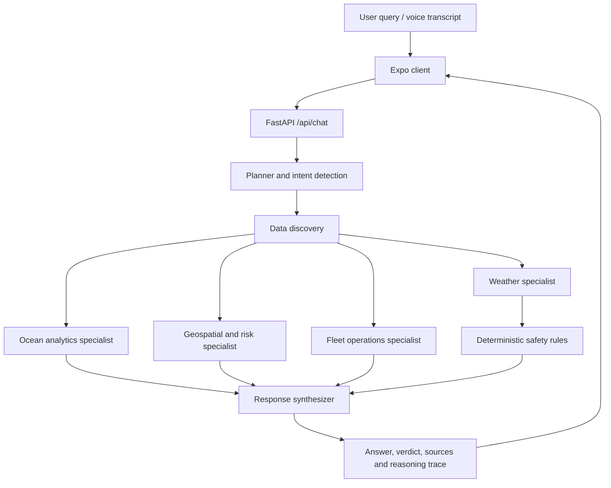

<!-- ORCA repository overview. Keep this file aligned with implementation. -->

<div align="center">

  <h1>ORCA</h1>
  <h3>Ocean Risk &amp; Coastal Advisory</h3>
  <p><strong>AI-assisted marine intelligence for coastal awareness and decision support.</strong></p>

  <p>
    <a href="https://orca-mobile-application.vercel.app">Live Application</a>
    ·
    <a href="DOCUMENTATION.md">Technical Documentation</a>
    ·
    <a href="https://github.com/Suryaakhilp18/ORCA_MOBILE_APP">Source Repository</a>
  </p>

  <p><strong>Stack:</strong> Expo 54 · React Native 0.81.5 · TypeScript 5.9 · Python · FastAPI</p>

</div>

---

## Project overview

ORCA (Ocean Risk & Coastal Advisory) is a mobile-first maritime information platform for exploring coastal conditions, marine alerts, geospatial context and fishing-related ocean indicators. It combines an Expo / React Native client with a Python FastAPI backend and a specialist-agent workflow.

The system is designed to turn marine information into explanations that are easier to understand, including multilingual text and voice interaction. A deterministic rules module evaluates configured sea-condition thresholds; generative AI is used for request interpretation and response synthesis, not as the authority for the safety verdict.

> **Data transparency:** The repository contains both a live Open-Meteo marine/weather adapter and regional mock/demo datasets. The live adapter can return live weather when a request succeeds. Regional PFZ examples, parts of the coastal registry, alerts and boundary information are mock/demo data in the current implementation. A feature's presence in the interface does not mean its underlying data is live or independently verified.

## Capability map

| Area | What the repository implements |
|---|---|
| Conversational marine assistant | Chat endpoint, session context, intent planning, specialist processing and response synthesis |
| Sea-condition assessment | Deterministic `SAFE`, `CAUTION` and `UNSAFE` evaluations using configured wind, wave, lightning and severe-weather inputs |
| Marine weather | Open-Meteo marine/weather adapter with fallback to regional demo data |
| Regional information | Coastal-region registry and region-selection/detection support |
| Fishing-related context | PFZ lookup and SST / chlorophyll-related demo indicators; availability and provenance vary by adapter |
| Geospatial processing | Distance, bearing, spatial boundary checks, nearest PFZ lookup and route-risk utilities |
| Alerts | Regional alert retrieval, notifications, and Server-Sent Events (SSE) endpoint |
| Saved locations | Save, list and delete location records, with optional vessel metadata |
| Voice | Audio transcription and speech generation service integration, with browser speech fallback in the client |
| Localization | Language detection and response support for Indian languages |

## Application modules

The mobile client uses Expo Router and a tab-based navigation structure.

| Module | Purpose |
|---|---|
| Home / Marine assistant | Conversational interaction, marine summaries, verdicts and reasoning context |
| Alerts | Regional alert cards, notifications and alert-stream connection |
| Saved locations | Stored locations, location selection and related actions |
| Shared components | Maps, situation cards, charts, radar-style presentation, language selection and verdict display |

The web client uses the same Expo application with web-specific API and storage handling where required.

## Agent workflow

The backend orchestration module separates request planning, data retrieval, specialist analysis and final response synthesis.



### Specialist responsibilities

| Specialist | Responsibility |
|---|---|
| Planner | Detects intent, language, region and query requirements |
| Data discovery | Selects the regional and marine datasets needed |
| Weather intelligence | Retrieves and interprets available weather information |
| Ocean analytics | Processes SST, chlorophyll and fishing-related indicators |
| Geospatial & risk | Performs spatial calculations and route / boundary checks |
| Fleet operations | Handles vessel-related context when supported by available inputs |
| Synthesizer | Produces the final user-facing explanation and structured context |

## Safety assessment

The deterministic rules are implemented in `backend/orchestrator/rules.py`. Current configured thresholds include:

| Factor | Caution threshold | Unsafe threshold |
|---|---:|---:|
| Wind speed | 18 kn | 25 kn |
| Wave height | 1.8 m | 2.5 m |
| Lightning probability | 30% | 60% |

An active cyclonic condition can also affect the assessment. Thresholds are configuration choices in the code, not universal maritime safety limits. The result depends on the completeness, freshness and geographic relevance of the weather input.

**Never interpret `SAFE` as official clearance to sail.** Missing, stale, demo or fallback data must not be treated as proof that conditions are safe.

## Data sources and provenance

| Data / service | Repository behaviour |
|---|---|
| Open-Meteo Marine / Weather | Live adapter in `backend/data_adapters/live_marine.py`; live data is used when retrieval succeeds |
| Regional registry | `backend/data_adapters/mock_region.py`; includes demo/reference values |
| PFZ, SST and chlorophyll examples | Regional demo values are present; do not present them as live satellite observations |
| Alerts and hazard examples | Regional demo content is present in the mock-region adapter |
| Geospatial boundaries | Served through the regional adapter and spatial utilities; validate source and freshness before operational use |
| Google Generative AI | Optional model integration used by the orchestration layer |
| Voice provider | Backend voice service; provider credentials/configuration are environment-dependent |
| Mapping | MapLibre assets and OpenStreetMap-based map presentation in the client |

Provider names in the application do not imply that every displayed layer is supplied live by that provider. Check source labels and mock/live metadata returned by the API.

## Technology stack

| Layer | Technology | Repository configuration |
|---|---|---|
| Client | Expo / React Native | Expo SDK 54, React Native 0.81.5 |
| UI runtime | React | 19.1.0 |
| Language | TypeScript | 5.9.3 |
| Routing | Expo Router | 6.0.24 |
| Backend | Python / FastAPI | FastAPI dependency in root requirements |
| ASGI server | Uvicorn | Root requirements |
| Validation | Pydantic | Pydantic 2 dependency |
| Model integration | Google Generative AI SDK | Python dependency |
| HTTP | HTTPX / Requests | Python dependencies |
| Persistence | MongoDB drivers | Motor and PyMongo dependencies |
| Audio | Expo Audio and browser speech APIs | Client and backend voice modules |
| Maps | MapLibre assets / OpenStreetMap | Frontend assets and map component |
| Hosting | Vercel configuration | Root and frontend Vercel configuration |

## Repository structure

```text
ORCA_MOBILE_APP/
├── api/
│   └── index.py                 # Deployment entry point
├── backend/
│   ├── data_adapters/
│   │   ├── live_marine.py       # Live marine/weather adapter
│   │   └── mock_region.py       # Regional demo/reference data
│   ├── gis/
│   │   └── spatial.py           # Geospatial utilities
│   ├── notifications/
│   │   └── service.py           # Alerts, notifications and geofencing
│   ├── orchestrator/
│   │   ├── agents.py             # Planner, specialists and synthesis
│   │   └── rules.py              # Deterministic safety rules
│   ├── voice/
│   │   └── service.py            # Voice service
│   ├── tests/                    # Backend test modules
│   ├── db.py                     # Persistence and fallback setup
│   └── server.py                 # FastAPI application
├── frontend/
│   ├── app/                      # Expo Router screens and tabs
│   ├── assets/                   # Runtime assets, fonts and map resources
│   └── src/
│       ├── components/           # Reusable interface components
│       ├── context/              # Shared application state
│       ├── hooks/                # Voice and alert hooks
│       ├── utils/                # Navigation and storage utilities
│       ├── api.ts                # API client
│       └── i18n.ts               # Localization
├── documentation/                # Generated project documents
├── memory/                       # Product requirements notes
├── tests/                        # Root test package
├── DOCUMENTATION.md              # Detailed project documentation
├── requirements.txt              # Python dependencies
├── test_result.md                # Test-agent protocol / test state
└── vercel.json                   # Root deployment routing
```

## Local development

### Prerequisites

- Git
- Node.js and npm
- Python 3.10 or newer (use the version supported by your deployment environment)
- API credentials for optional external integrations

### 1. Clone

```bash
git clone https://github.com/Suryaakhilp18/ORCA_MOBILE_APP.git
cd ORCA_MOBILE_APP
```

### 2. Create a Python environment

**Windows PowerShell**

```powershell
python -m venv .venv
.\.venv\Scripts\Activate.ps1
pip install -r requirements.txt
```

**macOS / Linux**

```bash
python -m venv .venv
source .venv/bin/activate
pip install -r requirements.txt
```

### 3. Start the backend

The FastAPI application is defined in `backend/server.py`. Run it from the backend directory:

```bash
cd backend
uvicorn server:app --reload
```

When the server starts, the health route is available at `/health`, and the API routes are mounted under `/api`. Interactive API documentation is available at `/docs` on the local server.

### 4. Start the frontend

Open another terminal:

```bash
cd frontend
npm install
npm run web
```

For a native development target:

```bash
npm run android
# or
npm run ios
```

The frontend's API client reads its service base URL from its runtime configuration. Configure the correct backend URL for your local, emulator or deployed environment before testing end-to-end flows.

## Backend API reference

The backend mounts its primary router under `/api`. The implementation includes the following route groups:

| Route | Methods | Purpose |
|---|---|---|
| `/api/health` | GET | API health check |
| `/api/chat` | POST | Conversational marine query |
| `/api/conversations/{session_id}` | GET | Retrieve session conversation |
| `/api/alerts` | GET | Regional alerts |
| `/api/alerts/stream` | GET | Server-Sent Events alert stream |
| `/api/situation` | GET | Regional situation summary |
| `/api/notifications` | GET | User notifications |
| `/api/notifications/register-token` | POST | Register a push token |
| `/api/locations` | GET, POST | List or save locations |
| `/api/locations/{location_id}` | DELETE | Delete a saved location |
| `/api/voice/speak` | POST | Generate speech |
| `/api/voice/transcribe` | POST | Transcribe audio |
| `/api/regions` | GET | List supported regions |
| `/api/regions/detect` | GET | Detect a region from coordinates |
| `/api/geocode` | GET | Geocoding lookup |

Additional route and schema details are available through FastAPI's Swagger interface at `/docs` when running locally. The table is a route overview; the running application is the source of truth for request schemas and availability.

## Configuration and secrets

External integrations are environment-dependent. Inspect the backend and frontend configuration before setting up a deployment. The repository's AI integration reads `GEMINI_API_KEY`; the voice service may require provider credentials depending on the selected voice path.

- Keep secrets in local environment files or deployment secret settings.
- Never commit API keys, tokens or credentials.
- Do not expose server-side secrets in client-side Expo configuration.
- Configure the frontend API base URL for the environment being tested.
- Treat external provider failures as unavailable data, not as safe conditions.

## Tests and validation

Backend test modules are in `backend/tests/`. From the repository root, run:

```bash
pytest backend/tests
```

The frontend defines a lint script. From the frontend directory:

```bash
npm run lint
```

Test-report artifacts exist under `test_reports/pytest/`; results may correspond to earlier iterations. Re-run tests against the current commit before quoting a pass count or claiming a release is verified.

## Safety, limitations and responsible use

ORCA is an informational and decision-support software project. It is **not** a certified navigation system, ECDIS, vessel traffic service, emergency communication system or official marine warning authority.

- Verify weather and sea conditions with current official bulletins and maritime authorities.
- Never rely on cached, mock, stale or missing data for a departure decision.
- Validate all routes against up-to-date nautical charts, depths, traffic separation schemes and local restrictions.
- AI-generated text can be incorrect or incomplete; review source context and timestamps.
- PFZ and ocean-productivity indicators are informational estimates, not guaranteed catch predictions.
- Network-dependent data and AI features may be unavailable offshore.
- The configured safety thresholds are software rules and are not a substitute for official maritime guidance.

For operational decisions, consult relevant authorities and official sources such as the India Meteorological Department (IMD), Indian National Centre for Ocean Information Services (INCOIS), port authorities and applicable maritime agencies.

## Project documentation

- [Detailed project documentation](DOCUMENTATION.md)
- [Backend source](backend/)
- [Frontend source](frontend/)
- [Backend tests](backend/tests/)
- [Deployment configuration](vercel.json)

## Contributing

1. Fork the repository.
2. Create a focused feature branch.
3. Keep changes scoped and document behaviour changes.
4. Run relevant backend tests and frontend lint checks.
5. Open a pull request with a summary and verification details.

## License

No license file is currently declared at the repository root. Contact the project owner before reusing, modifying or redistributing this project.

---

<div align="center">
  <strong>ORCA — Intelligence for Safer Seas</strong>
  <p>Marine information and decision support, built with software, data and AI.</p>
</div>
