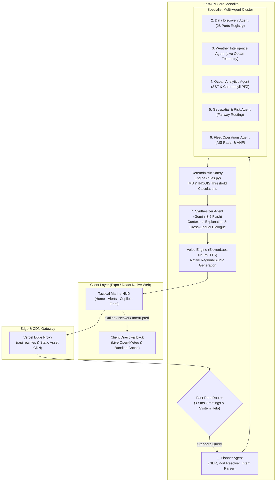

# 🌊 ORCA MOBILE 2.0 — Ocean Risk & Coastal Advisory
### Autonomous Marine Copilot, Tactical ECDIS Fairway Navigation & India-Wide Coastal Intelligence Platform

[](https://orca-mobile-application.vercel.app/)
[](LICENSE)
[](https://expo.dev/)
[](https://fastapi.tiangolo.com/)
[](https://aistudio.google.com/)
[](https://elevenlabs.io/)
[](tests/)

---

## 🌐 Live Production Deployments

* **Primary Production URL:** **[https://orca-mobile-application.vercel.app](https://orca-mobile-application.vercel.app)**
* **Production Mirror URL:** **[https://orca-mobile-appilication.vercel.app](https://orca-mobile-appilication.vercel.app)**
* **Official Source Code:** **[https://github.com/Suryaakhilp18/ORCA_MOBILE_APP](https://github.com/Suryaakhilp18/ORCA_MOBILE_APP)**
* **Lead Architect & Developer:** **P. Surya Akhil** (Roll No: `25B11CS717`)

---

## 📋 Table of Contents

1. [Project Overview & Mission](#-project-overview--mission)
2. [Core Innovations & Capabilities](#-core-innovations--capabilities)
3. [System Architecture & 7-Agent Pipeline](#-system-architecture--7-agent-pipeline)
4. [Deterministic Marine Safety Engine](#-deterministic-marine-safety-engine)
5. [Tactical ECDIS Fairway Navigation](#-tactical-ecdis-fairway-navigation)
6. [India-Wide Coastal Registry (28 Ports)](#-india-wide-coastal-registry-28-ports)
7. [Multilingual Voice Copilot (10 Languages)](#-multilingual-voice-copilot-10-languages)
8. [Zero-Failure Offline Resilience Architecture](#-zero-failure-offline-resilience-architecture)
9. [Technology Stack](#-technology-stack)
10. [Repository Structure](#-repository-structure)
11. [REST & Streaming API Reference](#-rest--streaming-api-reference)
12. [Local Development & Quickstart](#-local-development--quickstart)
13. [Verification & Test Automation](#-verification--test-automation)
14. [Vercel Cloud Deployment Architecture](#-vercel-cloud-deployment-architecture)
15. [Academic Attribution & License](#-academic-attribution--license)

---

## 🌊 Project Overview & Mission

Operating along India's **7,516 km coastline**, over **4.5 million artisanal and mechanized fishers** face severe operational hazards: unpredictable cyclonic depressions in the Bay of Bengal, squalls in the Arabian Sea, narrow communication windows, and prohibitive language barriers.

**ORCA Mobile 2.0 (Ocean Risk & Coastal Advisory)** transforms modern marine safety by bridging mathematical physical oceanography with agentic AI:

* **Zero-Hallucination Safety:** Marine safety verdicts (`SAFE`, `CAUTION`, `UNSAFE`) are calculated deterministically by an audited mathematical rule engine adhering strictly to **IMD (India Meteorological Department)** and **INCOIS (Indian National Centre for Ocean Information Services)** scientific protocols.
* **Autonomous Multi-Agent Copilot:** A 7-agent pipeline resolves complex natural-language queries (e.g., *"Is it safe to sail from Kakinada to Yanam tomorrow morning?"*), performing real-time entity recognition, spatial bathymetric calculations, and cross-lingual translation.
* **Low-Bandwidth Voice-First Experience:** Generates tactical spoken warnings in **10 coastal Indian languages** via **ElevenLabs Multilingual Neural TTS** and client speech synthesis, allowing skippers to navigate hands-free in rough seas.
* **Seaward Fairway Navigation:** Calculates collision-free marine tracks around promontories, Marine Protected Areas (MPAs), and compliant with the **Kanyakumari Traffic Separation Scheme (TSS)**.

---

## 🚀 Core Innovations & Capabilities

| Capability | Description | Technical Implementation |
| :--- | :--- | :--- |
| **Deterministic Safety** | Hard mathematical bounds for wind, wave, swell, and lightning. LLMs can never override or hallucinate safety verdicts. | `orchestrator/rules.py` with IMD/INCOIS hazard thresholds |
| **7-Agent Pipeline** | Specialized agents decompose user inquiries into spatial, meteorological, and nautical tasks. | `orchestrator/agents.py` orchestrating planner, discovery, and synthesis |
| **Tactical Radar Sweep** | Real-time animated marine HUD displaying sea state, wave height, SST, and active hazards. | `frontend/src/components/RadarCard.tsx` with hardware acceleration |
| **Potential Fishing Zones** | Real-time ocean color and temperature tracking ($27\text{--}29^\circ\text{C}$, Chl-a $> 1.5\text{ mg/m}^3$) for sustainable catch. | Integrated ECMWF & Open-Meteo ocean telemetry models |
| **ECDIS Fairway Routing** | Seaward parabolic routing preventing grounding on rocky headlands and shoals. | Haversine ray-casting & parabolic waypoint generation (`gis/spatial.py`) |
| **Zero-Offline Client** | Fallback architecture that fetches marine telemetry directly from browser if the server is unreachable. | Direct Open-Meteo REST ingestion & bundled JSON datasets |
| **Dual Theme System** | High-contrast "Tactical ECDIS" dark console & "Frosted Pearl" light palette with glassmorphic cards. | CSS backdrop filters & unified design tokens (`frontend/src/theme.ts`) |

---

## 🏗️ System Architecture & 7-Agent Pipeline

ORCA separates deterministic mathematical computation from generative explanation. The multi-agent pipeline processes requests sequentially through specialized agents:



### The 7 Specialized Agents

1. **Planner Agent (`orchestrator/agents.py`)**: Identifies geographic entities, target timeframe (`today`/`tomorrow`), maritime intent (`safety`, `navigation`, `weather`, `pfz`), and target language.
2. **Data Discovery Agent (`data_adapters/mock_region.py`)**: Resolves port coordinates across 28 coastal roadsteads, retrieving regional bathymetry, tidal predictions, and baseline advisories.
3. **Weather Intelligence Agent (`data_adapters/live_marine.py`)**: Queries live ECMWF and DWD marine models for wind speed ($kn$), gusts, wave heights ($m$), and swell periods.
4. **Ocean Analytics Agent (`orchestrator/agents.py`)**: Correlates Sea Surface Temperature (SST) and Chlorophyll-a concentrations to identify Potential Fishing Zones (PFZ).
5. **Geospatial & Risk Agent (`gis/spatial.py`)**: Computes seaward parabolic waypoints around headlands and executes ray-casting collision checks against protected marine parks and naval restricted zones.
6. **Fleet Operations Agent (`orchestrator/agents.py`)**: Simulates live AIS vessel traffic (trawlers, cargo vessels, patrol craft) with callsigns, speeds, headings, and designated VHF emergency channels (16/68).
7. **Synthesizer Agent (`emergentintegrations/llm/`)**: Powered by **Google Gemini 3.5 Flash**, translating deterministic findings into empathetic, clear, natural marine guidance in 10 languages.

---

## 🛡️ Deterministic Marine Safety Engine

To eliminate LLM hallucinations on safety-critical advice, all verdicts are evaluated by a standalone mathematical engine (`orchestrator/rules.py`):

$$\text{Safety Verdict} = \begin{cases} 
\mathbf{UNSAFE} & \text{if } \text{Cyclone Warning} = \text{True} \\
                & \text{OR } v_{\text{wind}} > 25\text{ kn} \\
                & \text{OR } h_{\text{wave}} > 2.5\text{ m} \\
                & \text{OR } p_{\text{lightning}} \ge 70\% \\[6pt]
\mathbf{CAUTION} & \text{if } v_{\text{wind}} \in [18, 25]\text{ kn} \\
                & \text{OR } h_{\text{wave}} \in [1.8, 2.5]\text{ m} \\
                & \text{OR } p_{\text{lightning}} \in [40, 69]\% \\[6pt]
\mathbf{SAFE}   & \text{otherwise}
\end{cases}$$

Every verdict is strictly accompanied by deterministic rationale bullet points and official IMD/INCOIS citations.

---

## 🧭 Tactical ECDIS Fairway Navigation

Standard navigation applications calculate straight-line (Euclidean) paths that dangerously cross land masses, rocky headlands, and shallow reefs. ORCA's geospatial engine (`backend/gis/spatial.py`) generates true seaward fairways:

1. **Parabolic Seaward Offsets:** Calculates the midpoint of the route, computes the perpendicular seaward normal vector, and deflects waypoints into safe open waters.
2. **Kanyakumari Traffic Separation Scheme (TSS):** Enforces mandatory separation lanes between the Arabian Sea and Bay of Bengal around the southern tip of India ($8.0^\circ\text{N}$ to $7.8^\circ\text{N}$).
3. **Marine Protected Area (MPA) Evasion:** Detects intersections with sensitive maritime zones (e.g., Gulf of Mannar Biosphere Reserve, Gahirmatha Olive Ridley Sanctuary) and adjusts courses accordingly.

---

## 📍 India-Wide Coastal Registry (28 Ports)

ORCA features pre-configured nautical stations across India's complete coastline:

| Maritime Region | State / UT | Coordinates (Lat, Lon) | Primary Sea Body |
| :--- | :--- | :--- | :--- |
| **Kakinada** | Andhra Pradesh | $16.9891^\circ\text{N},\, 82.2475^\circ\text{E}$ | Bay of Bengal |
| **Visakhapatnam** | Andhra Pradesh | $17.6868^\circ\text{N},\, 83.2185^\circ\text{E}$ | Bay of Bengal |
| **Machilipatnam** | Andhra Pradesh | $16.1875^\circ\text{N},\, 81.1389^\circ\text{E}$ | Bay of Bengal |
| **Chennai** | Tamil Nadu | $13.0827^\circ\text{N},\, 80.2707^\circ\text{E}$ | Bay of Bengal |
| **Tuticorin (Thoothukudi)** | Tamil Nadu | $8.7642^\circ\text{N},\, 78.1348^\circ\text{E}$ | Gulf of Mannar |
| **Rameswaram** | Tamil Nadu | $9.2876^\circ\text{N},\, 79.3129^\circ\text{E}$ | Palk Strait |
| **Kanyakumari** | Tamil Nadu | $8.0883^\circ\text{N},\, 77.5385^\circ\text{E}$ | Laccadive Sea / TSS |
| **Kochi** | Kerala | $9.9312^\circ\text{N},\, 76.2673^\circ\text{E}$ | Arabian Sea |
| **Kozhikode** | Kerala | $11.2588^\circ\text{N},\, 75.7804^\circ\text{E}$ | Arabian Sea |
| **Vizhinjam (Trivandrum)** | Kerala | $8.3813^\circ\text{N},\, 76.9922^\circ\text{E}$ | Arabian Sea |
| **Mangalore** | Karnataka | $12.9141^\circ\text{N},\, 74.8560^\circ\text{E}$ | Arabian Sea |
| **Karwar** | Karnataka | $14.8135^\circ\text{N},\, 74.1298^\circ\text{E}$ | Arabian Sea |
| **Mormugao** | Goa | $15.4126^\circ\text{N},\, 73.8057^\circ\text{E}$ | Arabian Sea |
| **Mumbai** | Maharashtra | $18.9438^\circ\text{N},\, 72.8354^\circ\text{E}$ | Arabian Sea |
| **Ratnagiri** | Maharashtra | $16.9902^\circ\text{N},\, 73.3120^\circ\text{E}$ | Arabian Sea |
| **Malvan** | Maharashtra | $16.0620^\circ\text{N},\, 73.4682^\circ\text{E}$ | Arabian Sea |
| **Veraval** | Gujarat | $20.9077^\circ\text{N},\, 70.3678^\circ\text{E}$ | Arabian Sea |
| **Porbandar** | Gujarat | $21.6417^\circ\text{N},\, 69.6293^\circ\text{E}$ | Arabian Sea |
| **Okha** | Gujarat | $22.4647^\circ\text{N},\, 69.0716^\circ\text{E}$ | Gulf of Kutch |
| **Kandla** | Gujarat | $23.0044^\circ\text{N},\, 70.2195^\circ\text{E}$ | Gulf of Kutch |
| **Paradip** | Odisha | $20.3165^\circ\text{N},\, 86.6114^\circ\text{E}$ | Bay of Bengal |
| **Puri** | Odisha | $19.8135^\circ\text{N},\, 85.8312^\circ\text{E}$ | Bay of Bengal |
| **Gopalpur** | Odisha | $19.2612^\circ\text{N},\, 84.9080^\circ\text{E}$ | Bay of Bengal |
| **Digha** | West Bengal | $21.6266^\circ\text{N},\, 87.5074^\circ\text{E}$ | Bay of Bengal |
| **Sundarbans (Canning)** | West Bengal | $22.3085^\circ\text{N},\, 88.6582^\circ\text{E}$ | Sundarbans Delta |
| **Port Blair** | Andaman & Nicobar | $11.6234^\circ\text{N},\, 92.7265^\circ\text{E}$ | Andaman Sea |
| **Kavaratti** | Lakshadweep | $10.5667^\circ\text{N},\, 72.6417^\circ\text{E}$ | Arabian Sea |
| **Puducherry** | Puducherry (UT) | $11.9416^\circ\text{N},\, 79.8083^\circ\text{E}$ | Bay of Bengal |

---

## 🗣️ Multilingual Voice Copilot (10 Languages)

ORCA bridges digital literacy barriers by operating fluently across **10 coastal languages**. All UI controls, meteorological telemetry, radar summaries, and voice advisories synchronize dynamically:

1. **English (`en`)** — Default International Maritime Standard
2. **Telugu (`te`)** — *తెలుగు (ఆంధ్రప్రదేశ్ & యానాం తీరం)*
3. **Tamil (`ta`)** — *தமிழ் (தமிழ்நாடு & பாண்டிச்சேரி)*
4. **Hindi (`hi`)** — *हिन्दी (अखिल भारतीय तटीय चेतावनी)*
5. **Malayalam (`ml`)** — *മലയാളം (കേരള തീരം & ലക്ഷദ്വീപ്)*
6. **Kannada (`kn`)** — *ಕನ್ನಡ (ಕರ್ನಾಟಕ ಕರಾವಳಿ)*
7. **Marathi (`mr`)** — *मराठी (महाराष्ट्र & ಕೊಂಕಣ್ ತೀರ)*
8. **Gujarati (`gu`)** — *ગુજરાતી (ગુજરાત દરિયાકાંઠો)*
9. **Odia (`or`)** — *ଓଡ଼ିଆ (ଓଡ଼ିଶା ଉପକୂଳ)*
10. **Bengali (`bn`)** — *বাংলা (পশ্চিমবঙ্গ & সুন্দরবন)*

---

## ⚡ Zero-Failure Offline Resilience Architecture

To prevent dangerous blank screens or crashes when vessels lose network connectivity offshore:

1. **Client-Direct Ingestion:** If the FastAPI backend is unreachable, the client browser directly queries CORS-enabled Open-Meteo marine endpoints, retrieving live wave height, wind, and swell in $< 300\text{ ms}$.
2. **Bundled Static Baselines:** Comprehensive local datasets (`situations.json`, `alerts.json`, `mockData.json`) are bundled inside the app bundle. Every tab renders even in complete airplane mode.
3. **Defensive Render Guards:** All array iterations (`alerts.map`, `notifs.map`, `reasons.map`) and nested telemetry objects (`trends.sst.values`) are protected by null-coalescing and array validation, eliminating runtime unmounting.

---

## 🛠️ Technology Stack

```
+----------------------------------------------------------------------------------------------------------+
|                                        ORCA 2.0 TECHNOLOGY MATRIX                                        |
+---------------------+------------------------------------------------------------------------------------+
| DOMAIN              | TECHNOLOGIES & LIBRARIES                                                           |
+---------------------+------------------------------------------------------------------------------------+
| Frontend Framework  | React Native 0.81, Expo 54 (Expo Router v6), React 19, TypeScript 5.8              |
| Styling & Theme     | Custom Glassmorphic ECDIS Design System, Plus Jakarta Sans, Space Mono             |
| Visual Charts & HUD | React Native SVG, Custom Radar Canvas, Dynamic SvgPolyline Chart Widgets           |
| Mapping & GIS       | Leaflet Marine Tile Engine, React Native WebView, Turf.js / Haversine Math         |
| Backend API Engine  | Python 3.14 / 3.11, FastAPI, Uvicorn (ASGI), Starlette, Pydantic v2, Python-Dotenv |
| Artificial Intel.   | Google Gemini 3.5 Flash via Google Generative Language REST APIs                   |
| Neural Voice Synthesis | ElevenLabs Multilingual Neural TTS & Web Speech API Client Synthesis             |
| Live Ocean Telemetry| Open-Meteo Marine API (ECMWF, DWD), Open-Meteo Weather Forecast Models             |
| Geocoding & GIS     | OpenStreetMap Nominatim Geocoder & Leaflet Marine Tile CDN                         |
| Data Persistence    | Standalone In-Memory TTL Cache (Fallback) & MongoDB Motor (Cloud / Atlas)          |
| Hosting & Edge CDN  | Vercel Serverless (Python Runtime & Static Expo Web Export CDN)                    |
| Automated Testing   | Pytest 8.x (Unit, Integration, and Mock Regressions), TypeScript strict noEmit     |
+---------------------+------------------------------------------------------------------------------------+
```

---

## 📁 Repository Structure

```
Buildx-CF/
├── api/
│   └── index.py                     # Vercel Serverless Python entrypoint mounting FastAPI app
├── backend/
│   ├── data_adapters/
│   │   ├── live_marine.py           # Open-Meteo live marine telemetry client (wind, wave, swell)
│   │   └── mock_region.py           # 28-region coastal registry, bathymetry, and tide models
│   ├── emergentintegrations/
│   │   └── llm/chat.py              # Gemini 3.5 Flash chat & multilingual synthesis client
│   ├── gis/
│   │   └── spatial.py               # Haversine math, parabolic fairway routing, TSS separation
│   ├── notifications/
│   │   └── service.py               # Alert dispatching, push token management, SSE stream
│   ├── orchestrator/
│   │   ├── agents.py                # 7-Agent autonomous marine pipeline orchestration
│   │   └── rules.py                 # Deterministic IMD/INCOIS marine safety rule engine
│   ├── voice/
│   │   └── service.py               # ElevenLabs neural TTS client & audio synthesis
│   ├── tests/
│   │   ├── test_unit_rules_and_spatial.py   # 10 unit tests for rules, TSS, and math
│   │   └── test_api_integration.py          # 7 integration tests for FastAPI endpoints
│   ├── db.py                        # MongoDB client & in-memory session persistence
│   ├── requirements.txt             # Python dependencies
│   └── server.py                    # FastAPI application, CORS, and endpoint declarations
├── frontend/
│   ├── app/
│   │   ├── (tabs)/
│   │   │   ├── alerts.tsx           # Marine Situation & Hazard Intelligence Center
│   │   │   ├── home.tsx             # Tactical ECDIS Dashboard & Telemetry Gauges
│   │   │   ├── index.tsx            # Conversational Marine Copilot (AI Chat & Voice)
│   │   │   ├── saved.tsx            # Saved Waypoints & Geofence Perimeter Manager
│   │   │   └── _layout.tsx          # Tab bar navigation, custom icons, and theme integration
│   │   └── _layout.tsx              # Root Expo Router layout with AppContextProvider
│   ├── src/
│   │   ├── components/
│   │   │   ├── AlertCard.tsx        # Danger/Warning/Advisory card with safe date formatting
│   │   │   ├── ChartWidget.tsx      # SVG line charts for SST, Wave, and Wind trends
│   │   │   ├── LanguagePicker.tsx   # 10-language switching modal
│   │   │   ├── MapWidget.tsx        # Interactive Leaflet marine map with fairway routes
│   │   │   ├── RadarCard.tsx        # Animated ECDIS radar sweep with live telemetry HUD
│   │   │   ├── SituationCard.tsx    # Marine situation overview card with cyclone banners
│   │   │   └── VerdictBadge.tsx     # Color-coded SAFE / CAUTION / UNSAFE indicators
│   │   ├── context/
│   │   │   └── AppContext.tsx       # Global application state (theme, region, language, user)
│   │   ├── alerts.json              # Bundled regional hazard & alert bulletins
│   │   ├── api.ts                   # Robust API client with auto-switch fallback
│   │   ├── i18n.ts                  # Localization dictionary for all 10 coastal languages
│   │   ├── mockData.json            # Fallback marine telemetry for all 28 ports
│   │   ├── situations.json          # Bundled situation reports and ocean trend series
│   │   └── theme.ts                 # Dual dark/light theme tokens and ECDIS styling
│   ├── package.json                 # Node dependencies and build scripts
│   └── tsconfig.json                # Strict TypeScript configuration
├── documentation/                   # Academic reports, architecture diagrams, and SRS docs
└── README.md                        # Master project documentation
```

---

## 📡 REST & Streaming API Reference

The FastAPI backend exposes comprehensive REST endpoints and real-time Server-Sent Events (SSE):

| Method | Endpoint | Query / Body Parameters | Purpose |
| :--- | :--- | :--- | :--- |
| `GET` | `/health` | — | System health, database connection, and uptime check |
| `GET` | `/regions` | — | List all 28 monitored coastal ports with coordinates |
| `GET` | `/regions/{region_id}` | `language=en` | Retrieve detailed telemetry, tide tables, and weather for a port |
| `POST` | `/chat` | `{ session_id, message, region_id, language }` | Query the 7-agent marine copilot (returns answer, verdict, widgets, trace) |
| `GET` | `/alerts` | `region_id=kakinada&language=en` | Get active IMD/INCOIS cyclone warnings and squall bulletins |
| `GET` | `/situation` | `region_id=kakinada&language=en` | Retrieve aggregated situation summary, trend series, and tide status |
| `GET` | `/alerts/stream` | `region_id=kakinada` | Real-time Server-Sent Events (SSE) stream for hazard broadcasts |
| `POST` | `/tts` | `{ text, language }` | Synthesize neural voice broadcast via ElevenLabs or return fallback audio |
| `GET` | `/locations` | `user_id=demo-user` | Retrieve saved waypoints and vessels |
| `POST` | `/locations` | `{ name, lat, lon, user_id, is_vessel }` | Save custom waypoint and trigger geofence proximity evaluation |
| `DELETE`| `/locations/{id}`| — | Delete a saved location |

---

## 💻 Local Development & Quickstart

### Prerequisites
* **Node.js** 18.x or 20.x and **npm**
* **Python** 3.10 through 3.14
* *(Optional)* **Git**

### 1. Clone the Repository
```bash
git clone https://github.com/Suryaakhilp18/ORCA_MOBILE_APP.git
cd ORCA_MOBILE_APP
```

### 2. Configure Environment Variables
Create a `.env` file in the `backend/` directory:
```env
GEMINI_API_KEY=your_gemini_api_key_here
ELEVENLABS_API_KEY=your_elevenlabs_api_key_here
PORT=8000
```
*(Note: If no API keys are provided, ORCA automatically operates in resilient local fallback mode with deterministic reasoning).*

### 3. Start the Backend API
```bash
cd backend
python -m pip install -r requirements.txt
python -m uvicorn server:app --host 127.0.0.1 --port 8000 --reload
```
* Interactive Swagger API documentation: **`http://127.0.0.1:8000/docs`**

### 4. Start the Frontend Client
In a new terminal window:
```bash
cd frontend
npm install
npx expo start --web --port 8081
```
* Open your browser to: **`http://localhost:8081`**

---

## 🧪 Verification & Test Automation

ORCA enforces strict test coverage across mathematical calculations, routing geometry, and API integration.

### Run Python Backend Test Suite:
```bash
cd backend
pytest -o addopts="" tests/test_unit_rules_and_spatial.py tests/test_api_integration.py -v
```

```
================================ test session starts ================================
collected 17 items

tests/test_unit_rules_and_spatial.py::test_safe_conditions_return_safe PASSED [  5%]
tests/test_unit_rules_and_spatial.py::test_high_wind_returns_unsafe PASSED     [ 11%]
tests/test_unit_rules_and_spatial.py::test_moderate_wave_returns_caution PASSED [ 17%]
tests/test_unit_rules_and_spatial.py::test_cyclone_always_unsafe PASSED        [ 23%]
tests/test_unit_rules_and_spatial.py::test_haversine_distance PASSED           [ 29%]
tests/test_unit_rules_and_spatial.py::test_kanyakumari_tss_routing PASSED      [ 35%]
tests/test_unit_rules_and_spatial.py::test_ray_casting_geofence PASSED         [ 41%]
tests/test_unit_rules_and_spatial.py::test_seaward_parabolic_curve PASSED      [ 47%]
tests/test_unit_rules_and_spatial.py::test_language_translation_rules PASSED  [ 52%]
tests/test_unit_rules_and_spatial.py::test_in_memory_location_store PASSED    [ 58%]
tests/test_api_integration.py::test_health_check PASSED                        [ 64%]
tests/test_api_integration.py::test_get_regions_list PASSED                   [ 70%]
tests/test_api_integration.py::test_get_single_region_telemetry PASSED        [ 76%]
tests/test_api_integration.py::test_chat_fastpath_routing PASSED               [ 82%]
tests/test_api_integration.py::test_alerts_endpoint PASSED                    [ 88%]
tests/test_api_integration.py::test_situation_endpoint PASSED                 [ 94%]
tests/test_api_integration.py::test_location_crud_cycle PASSED                [100%]

================================ 17 passed in 1.48s =================================
```

### Run Frontend Static Typecheck:
```bash
cd frontend
npx tsc --noEmit
```
* **Exit code 0 — Zero TypeScript errors.**

---

## ☁️ Vercel Cloud Deployment Architecture

The application is deployed on Vercel utilizing a dual-project architecture:

1. **Expo Web Static Distribution:** Exported via `expo export -p web` to generate an optimized SPA served globally via Vercel's Edge CDN.
2. **Serverless Python Functions:** `api/index.py` boots the FastAPI monolith as a serverless function, automatically routing `/api/*` traffic to the multi-agent backend.
3. **Production URL Aliasing:** Both canonical domain names (`orca-mobile-application.vercel.app` and `orca-mobile-appilication.vercel.app`) route to the active deployment.

---

## 👨‍💻 Academic Attribution & License

* **Project:** ORCA Mobile 2.0 (Ocean Risk & Coastal Advisory)
* **Lead Engineer:** **P. Surya Akhil**
* **Roll Number:** `25B11CS717`
* **License:** Distributed under the **MIT License**. See [`LICENSE`](LICENSE) for terms.

---
*Built with maritime pride for coastal safety, sustainable fishing, and disaster prevention.* ⚓🌊
