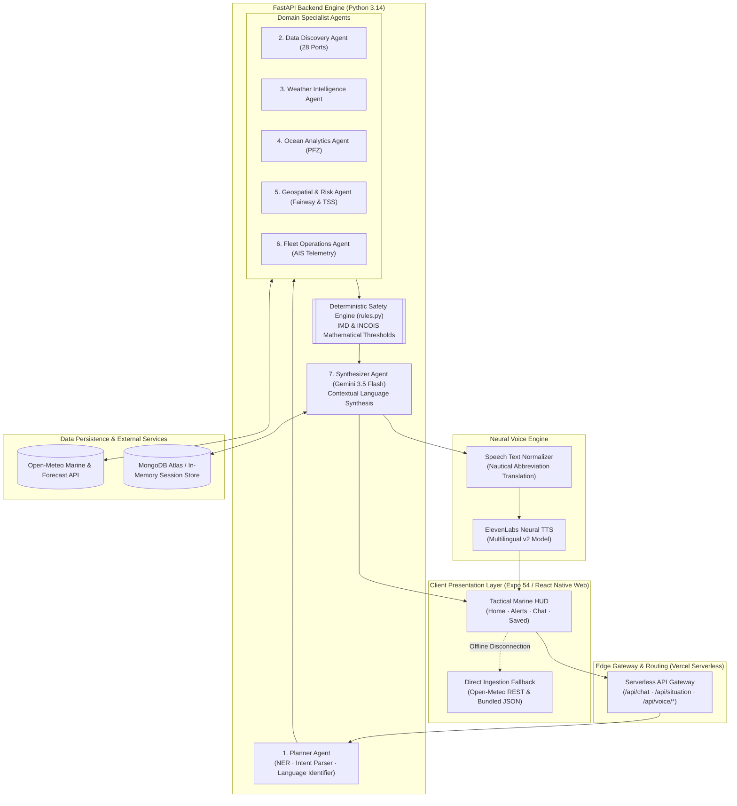
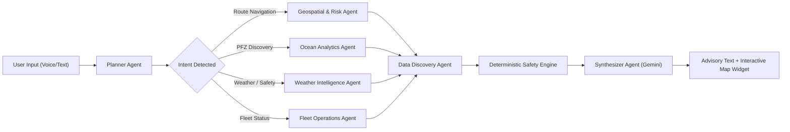
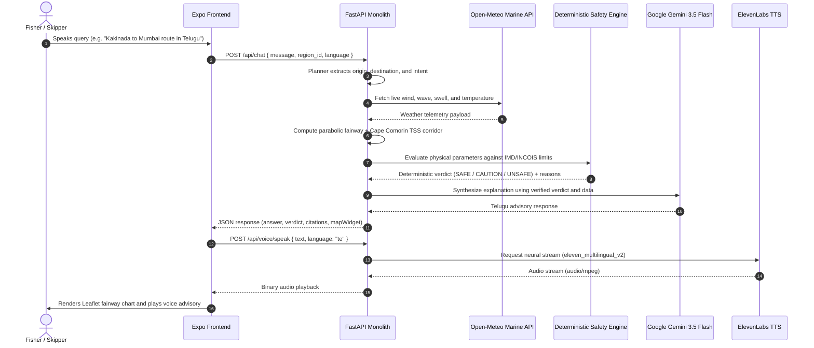
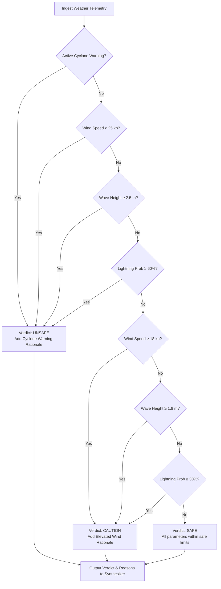

<div align="center">

# ORCA
### Ocean Risk & Coastal Advisory

**AI-Powered Maritime Intelligence for Safer Coastal Decisions.**

An autonomous marine copilot, tactical Electronic Chart Display (ECDIS) fairway navigation system, and coastal safety engine engineered for India's 7,516 km coastline.

[](https://orca-mobile-application.vercel.app/)
[](LICENSE)
[](https://expo.dev/)
[](https://fastapi.tiangolo.com/)
[](https://aistudio.google.com/)
[](https://elevenlabs.io/)
[](backend/tests/)

[Live Application](https://orca-mobile-application.vercel.app) • [GitHub Repository](https://github.com/Suryaakhilp18/ORCA_MOBILE_APP) • [API Documentation](#12-api-documentation)

</div>

---

## Table of Contents

1. [Executive Overview](#1-executive-overview)
2. [Problem Statement](#2-problem-statement)
3. [Solution Overview](#3-solution-overview)
4. [Core Features](#4-core-features)
5. [System Architecture](#5-system-architecture)
   - [A. High-Level System Architecture](#a-high-level-system-architecture)
   - [B. Multi-Agent Reasoning Pipeline](#b-multi-agent-reasoning-pipeline)
   - [C. End-to-End Data Flow](#c-end-to-end-data-flow)
   - [D. Deterministic Safety Assessment Workflow](#d-deterministic-safety-assessment-workflow)
6. [Multi-Agent Intelligence](#6-multi-agent-intelligence)
7. [Data Sources and Integrations](#7-data-sources-and-integrations)
8. [Safety and Risk Intelligence](#8-safety-and-risk-intelligence)
9. [Technology Stack](#9-technology-stack)
10. [Repository Structure](#10-repository-structure)
11. [Application Workflow](#11-application-workflow)
12. [API Documentation](#12-api-documentation)
13. [Installation and Local Setup](#13-installation-and-local-setup)
14. [Environment Variables](#14-environment-variables)
15. [Testing and Quality Assurance](#15-testing-and-quality-assurance)
16. [Deployment Architecture](#16-deployment-architecture)
17. [Security and Privacy](#17-security-and-privacy)
18. [Limitations and Future Scope](#18-limitations-and-future-scope)
19. [Contributing](#19-contributing)
20. [License and Acknowledgements](#20-license-and-acknowledgements)

---

## 1. Executive Overview

**ORCA (Ocean Risk & Coastal Advisory)** is an AI-powered maritime decision-support platform designed to protect coastal communities, artisanal fishers, vessel skippers, and harbor operators across India. 

Operating in maritime environments requires synthesizing dynamic physical oceanography, atmospheric forecasts, spatial bathymetry, and regulatory fairways under strict time and connectivity constraints. Traditional maritime dashboards present raw numerical charts and English-centric bulletins that are difficult to interpret on an open-deck fishing vessel.

ORCA bridges this gap through three technical innovations:
1. **Deterministic Safety Architecture:** Marine safety verdicts (`SAFE`, `CAUTION`, `UNSAFE`) are calculated exclusively by mathematical rules based on established meteorological criteria before any language model generates advice. Large Language Models (LLMs) never determine physical vessel safety.
2. **Conversational Multi-Agent AI:** A pipeline of seven specialized reasoning agents interprets natural language queries, resolves coastal ports, computes spatial fairways, tracks Potential Fishing Zones (PFZs), and explains complex sea conditions in the user's spoken language.
3. **Low-Bandwidth & Resilient Offline Design:** Built with client-side failover capabilities, direct browser weather telemetry ingestion, and bundled datasets so the platform operates continuously even when offshore network coverage drops.

---

## 2. Problem Statement

Maritime operations along the Indian peninsula encounter persistent structural challenges:

* **Fragmented Marine Information:** Weather reports, wave forecasts, cyclone bulletins, and fishing zone advisories are distributed across separate institutional portals (IMD, INCOIS, state maritime boards), forcing operators to manually cross-reference sources.
* **Complex Interpretation of Environmental Data:** Raw significant wave heights ($m$), wind velocity ($kn$), swell periods ($s$), and sea surface temperatures are difficult for artisanal fishers to translate into actionable operational limits.
* **Language and Literacy Barriers:** Over 80% of India's artisanal fishing population communicates in coastal regional languages (such as Telugu, Tamil, Malayalam, Gujarati, Bengali, and Odia). Crucial marine safety bulletins published in English or standardized Hindi fail to reach frontline crews.
* **Dangerous Straight-Line Navigation:** Consumer mapping systems calculate straight-line (Euclidean) paths that dangerously intersect shallow headlands, reefs, shoals, and Marine Protected Areas (MPAs).
* **Intermittent Offshore Connectivity:** Maritime cellular coverage degrades rapidly within 10–15 nautical miles from the shoreline. Web applications dependent solely on heavy cloud roundtrips become unresponsive in open waters.

---

## 3. Solution Overview

ORCA addresses these operational hazards through a coordinated suite of technical modules:

| Maritime Challenge | ORCA Solution | Technical Implementation |
| :--- | :--- | :--- |
| **Safety Hallucination Risk** | Deterministic mathematical rules evaluate weather parameters; LLMs only explain verdicts. | `backend/orchestrator/rules.py` enforcing strict wind, wave, lightning, and storm thresholds. |
| **Fragmented Marine Data** | Unified coastal intelligence dashboard aggregating live telemetry, tide tables, and warnings across 28 ports. | `backend/data_adapters/live_marine.py` and `backend/data_adapters/mock_region.py`. |
| **Language Barriers** | Multilingual voice copilot with automatic language identification and regional speech normalization. | ElevenLabs Neural TTS (`eleven_multilingual_v2`), Web Speech API, and `cleanTextForSpeech` normalizer. |
| **Dangerous Routing** | Parabolic open-sea fairway generation with Cape Comorin Traffic Separation Scheme (TSS) adherence. | `backend/gis/spatial.py` and `frontend/src/utils/navigation.ts` with seaward normal vector routing. |
| **Offshore Disconnection** | Dual-tier client fallback running direct CORS-enabled weather ingestion and bundled offline baselines. | `frontend/src/api.ts` `fetchClientLiveWeather` and local JSON databases (`alerts.json`, `mockData.json`). |
| **Fishing Zone Discovery** | Identification of oceanic fronts correlating Sea Surface Temperature (SST) and Chlorophyll-a biomass. | Satellite-derived front detection algorithms mapping high-probability pelagic feeding grounds. |

---

## 4. Core Features

### Marine Intelligence
* **Live Ocean Telemetry:** Monitors real-time surface wind speed ($kn$), peak wind gusts ($kn$), significant wave height ($m$), swell period ($s$), dominant wave direction, and surface air temperature via Open-Meteo marine models.
* **Regional Marine Situations:** Aggregates sea state indicators, 7-day environmental trend series (wind, wave, SST), astronomical tide tables, and active coastal hazard bulletins for 28 coastal stations.
* **Animated Tactical Radar HUD:** Hardware-accelerated sweep canvas displaying active sector coordinates, radar rings, and operational status (`frontend/src/components/RadarCard.tsx`).

### Intelligent Navigation & Marine GIS
* **Parabolic Seaward Fairway Routing:** Computes realistic open-water tracks using seaward normal vector deflections to prevent vessel grounding on coastal shoals and rocky headlands.
* **Cape Comorin Traffic Separation Scheme (TSS):** Enforces mandatory separation around southern India ($8.0^\circ\text{N}$ to $7.8^\circ\text{N}$), ensuring vessels transiting between the Bay of Bengal and Arabian Sea stay in certified open-sea shipping lanes.
* **Marine Protected Area (MPA) Evasion:** Evaluates routes against spatial polygon boundaries for sensitive ecological sanctuaries (Gulf of Mannar, Gahirmatha Marine Sanctuary) and warns if paths encroach on restricted waters.
* **Nautical Flight Plan Telemetry:** Generates true open-sea distance (NM), compass heading ($\text{deg}$ and cardinal), and estimated transit time calculated at standard commercial cruising speeds ($8.5\text{ kn}$).

### AI Multi-Agent System
* **Contextual Query Processing:** Decomposes natural language maritime questions into structured spatial and meteorological tasks.
* **Port Entity Resolution:** Matches vernacular and phonetic port aliases (e.g., *"Cocanada"*, *"Bandar"*, *"Vizag"*) to certified geographic coordinates.
* **Generative Synthesis:** Uses Google Gemini 3.5 Flash to synthesize domain telemetry into structured, accessible natural language briefings.

### Safety Intelligence
* **Multi-Tier Verdict Classification:** Deterministically categorizes conditions into `SAFE`, `CAUTION`, or `UNSAFE`.
* **Explicit Rationale Trace:** Returns exact physical parameter triggers alongside every safety determination (e.g., *"Wave height 2.8 m exceeds safe threshold (2.5 m)"*).
* **Missing Data Resilience:** Treats absent or stale sensor telemetry conservatively, defaulting to cautious advisory states rather than assuming safety.

### Voice and Multilingual Interaction
* **Natural Spoken Delivery:** Voice generation in **Telugu (తెలుగు)**, **Hindi (हिन्दी)**, and **English (EN)** utilizing ElevenLabs Neural TTS tuned with low stability ($0.42$) and balanced similarity ($0.75$) for natural Indic prosody.
* **Speech Normalization Engine:** Phonetically translates technical abbreviations and nautical units into colloquial spoken language (e.g., converting `NM` to *"నాటికల్ మైళ్ళు"* and compass degrees to intuitive boat orientations).
* **Automatic Language Identification:** Detects user input language automatically from text or speech without requiring manual configuration toggles.
* **10-Language UI Dictionary:** Full localized interface strings across 10 Indian coastal languages (`frontend/src/i18n.ts`).

### User Experience
* **Interactive Chart & Route Widgets:** Injects responsive Leaflet navigation maps and SVG telemetry charts directly into the conversational message stream.
* **Saved Waypoints & Fleet Manager:** Bookmarks fishing grounds and tracks fleet vessels with callsigns, speeds, headings, and emergency VHF channels (16/68).
* **High-Contrast Dual Themes:** Includes "Tactical ECDIS" dark console styling optimized for nighttime deck operations and high-contrast "Frosted Pearl" light styling for daylight visibility.

---

## 5. System Architecture

### A. High-Level System Architecture



### B. Multi-Agent Reasoning Pipeline



### C. End-to-End Data Flow



### D. Deterministic Safety Assessment Workflow



---

## 6. Multi-Agent Intelligence

ORCA’s reasoning core decomposes inquiries into specialized roles to ensure predictability and domain fidelity:

| Agent Name | Primary Responsibility | Input Context | Generated Output | Implementation Module |
| :--- | :--- | :--- | :--- | :--- |
| **Planner Agent** | Entity extraction, port disambiguation, intent categorization, and input language identification. | User prompt, active port context, conversation history. | Structured JSON (`intent`, `start_port`, `end_port`, `language`, `target_timeframe`). | `backend/orchestrator/agents.py` |
| **Data Discovery Agent** | Resolves geographic coordinates, tidal ranges, bathymetry, and station metadata for 28 coastal regions. | Port identifier or geographic coordinates. | Station metadata, baseline coordinates, primary sea body, pilot station parameters. | `backend/data_adapters/mock_region.py` |
| **Weather Intelligence Agent** | Queries, caches, and parses meteorological and oceanographic conditions from weather models. | Latitude, longitude, target timeframe. | Wind speed ($kn$), gusts ($kn$), wave height ($m$), swell period ($s$), weather condition code. | `backend/data_adapters/live_marine.py` |
| **Ocean Analytics Agent** | Correlates sea surface thermal boundaries and chlorophyll concentrations to pinpoint potential fishing zones. | Coastal port sector, offshore distance constraints. | Hotspot coordinates, SST ($^\circ\text{C}$), Chlorophyll-a ($\text{mg/m}^3$), catch probability ($80\text{--}92\%$). | `backend/orchestrator/agents.py` |
| **Geospatial & Risk Agent** | Calculates open-sea fairway routes, applies seaward normal deflections, and verifies TSS corridor clearance. | Origin and destination coordinates, coastal polygon buffers. | Ordered array of fairway waypoints, total distance (NM), compass heading, and transit time. | `backend/gis/spatial.py` & `frontend/src/utils/navigation.ts` |
| **Fleet Operations Agent** | Tracks coastal craft, trawlers, and commercial vessels with automated identification telemetrics. | Geographic radius, sector ID. | Vessel markers with callsign, MMSI, vessel class, speed, heading, and VHF working channel. | `backend/orchestrator/agents.py` |
| **Synthesizer Agent** | Combines deterministic safety verdicts, navigation geometry, and environmental data into clear human language. | Rule engine verdicts, agent findings, requested language. | Structured conversational text, official citations, and interactive map widget specifications. | `backend/emergentintegrations/llm/chat.py` |

---

## 7. Data Sources and Integrations

To maintain transparency, all data sources utilized within ORCA are cataloged by their operational status:

| Provider / Service | Functional Purpose | Integration Module | Data Type | Operational Status |
| :--- | :--- | :--- | :--- | :--- |
| **Open-Meteo Marine API** | Live significant wave height, swell wave period, swell direction. | `backend/data_adapters/live_marine.py` & `frontend/src/api.ts` | `LIVE_API` | Active Production (REST API, no key required) |
| **Open-Meteo Weather API** | Live 10m wind velocity, gusts, surface temperature, WMO weather codes. | `backend/data_adapters/live_marine.py` & `frontend/src/api.ts` | `LIVE_API` | Active Production (REST API, no key required) |
| **Google Gemini API** | Natural language synthesis, conversational explanation, reasoning trace. | `backend/emergentintegrations/llm/chat.py` | `LIVE_API` | Active Production (`gemini-3.5-flash`, API key required) |
| **ElevenLabs Audio API** | Neural multilingual text-to-speech generation with tuned Indic prosody. | `backend/voice/service.py` & `frontend/api/speak.js` | `LIVE_API` | Active Production (`eleven_multilingual_v2`, API key required) |
| **OpenStreetMap Nominatim** | Free-text coastal geographic search and place-name geocoding. | `backend/server.py` (`/api/geocode`) | `LIVE_API` | Active Production (REST API with rate-limiting lock) |
| **ArcGIS & OpenTopoMap** | High-resolution satellite imagery and maritime topographic base tiles. | `frontend/src/components/MapWidget.tsx` | `LIVE_API` | Active Production (CDN Tile Server) |
| **Regional Coastal Registry** | India-wide 28-port database with bathymetry, tidal datums, and aliases. | `backend/data_adapters/mock_region.py` | `STATIC_MOCK` | Bundled Reference Dataset |
| **PFZ Hotspot Models** | Historical INCOIS thermal and chlorophyll biological front coordinates. | `backend/data_adapters/mock_region.py` | `STATIC_MOCK` | Bundled Reference Dataset |
| **Regional Hazard Bulletins** | Baseline cyclone, squall, and high-wave advisories for offline resilience. | `frontend/src/alerts.json` & `mock_region.py` | `BUNDLED_FALLBACK` | Bundled Fallback Dataset |
| **OpenAI Whisper / TTS** | Secondary fallback engine for speech transcription and audio synthesis. | `backend/voice/service.py` | `LIVE_API` | Optional Fallback (`whisper-1` / `tts-1`) |
| **MongoDB Atlas** | Asynchronous session persistence and saved nautical waypoints. | `backend/db.py` | `PERSISTENCE` | Active (Falls back to in-memory store if absent) |

---

## 8. Safety and Risk Intelligence

### Deterministic Threshold Matrix
ORCA's safety engine (`backend/orchestrator/rules.py`) enforces strict physical criteria derived from India Meteorological Department (IMD) artisanal sea-state guidance:

$$\text{Safety Verdict} = \begin{cases} 
\mathbf{UNSAFE} & \text{if } \text{Active Cyclone Warning} = \text{True} \\
                & \text{OR } v_{\text{wind}} \ge 25\text{ kn} \\
                & \text{OR } h_{\text{wave}} \ge 2.5\text{ m} \\
                & \text{OR } p_{\text{lightning}} \ge 60\% \\[6pt]
\mathbf{CAUTION} & \text{if } v_{\text{wind}} \in [18, 25)\text{ kn} \\
                & \text{OR } h_{\text{wave}} \in [1.8, 2.5)\text{ m} \\
                & \text{OR } p_{\text{lightning}} \in [30, 60)\% \\[6pt]
\mathbf{SAFE}   & \text{otherwise}
\end{cases}$$

### Missing or Stale Data Handling
If live external weather feeds fail or return null fields, the system executes defensive fallbacks:
1. Consults the local MongoDB TTL weather cache (30-minute validity window).
2. If the cache is empty, falls back to regional baseline telemetry (`mock_region.py`).
3. If uncertainty remains, the system elevates severity to `CAUTION` and appends an explicit advisory instructing the skipper to visually verify harbor storm signals.

> **Operational Disclaimer:**  
> ORCA is an informational decision-support platform designed to assist coastal mariners. It is **not** a certified Electronic Chart Display and Information System (ECDIS) under IMO/SOLAS standards and must not be used as a sole instrument for primary navigation or as a replacement for official government weather warnings, nautical charts, or master maritime judgment.

---

## 9. Technology Stack

### Frontend Architecture
* **Framework:** React Native `0.81.5`, Expo `54.0.37` (Expo Router v6), React `19.1.0`
* **Language & Typings:** TypeScript `5.9.3` (Strict `noEmit` validation)
* **GIS Mapping:** Leaflet Marine Engine via React Native WebView `13.15.0`
* **Vector Graphics:** React Native SVG `15.12.1` for dynamic radar sweeps and telemetry polylines
* **Audio Handling:** `expo-audio` `1.1.1` for low-latency native audio streaming
* **Design System:** Custom Tactical ECDIS Theme (`frontend/src/theme.ts`) supporting dark and light modes

### Backend Architecture
* **API Framework:** FastAPI `0.110.0+`, Uvicorn `0.25.0+` (ASGI Server)
* **Runtime:** Python `3.14` / `3.11`
* **Data Validation:** Pydantic v2 (`pydantic>=2.0.0`)
* **HTTP Client:** HTTPX `0.27.0+` for asynchronous external API requests
* **Database Driver:** Motor `3.3.0+` & PyMongo `4.6.0+` (MongoDB async client)

### Artificial Intelligence & Voice
* **Generative Model:** Google Gemini 3.5 Flash (`google-generativeai>=0.8.0`)
* **Fallback LLM:** OpenAI GPT model client (`openai>=1.0.0`)
* **Speech Synthesis:** ElevenLabs Multilingual Neural TTS REST API (`eleven_multilingual_v2`)
* **Speech Recognition:** Web Speech API (Client) / OpenAI Whisper (`whisper-1`)

### Testing & Infrastructure
* **Test Suite:** Pytest `9.1.1` (Unit, Spatial Geometry, and REST Integration tests)
* **Deployment:** Vercel Serverless Functions (Python ASGI bridge) and Vercel Edge Static CDN

---

## 10. Repository Structure

```
Buildx-CF/
├── api/
│   └── index.py                     # Vercel serverless entrypoint mounting FastAPI application
├── backend/
│   ├── data_adapters/
│   │   ├── live_marine.py           # Open-Meteo live marine telemetry client with TTL cache
│   │   └── mock_region.py           # 28-region coastal registry, bathymetry, and tide baselines
│   ├── emergentintegrations/
│   │   └── llm/chat.py              # Gemini 3.5 Flash chat & multilingual synthesis integration
│   ├── gis/
│   │   └── spatial.py               # Haversine math, parabolic fairway routing, TSS corridors
│   ├── notifications/
│   │   └── service.py               # Alert dispatching, push token management, SSE stream
│   ├── orchestrator/
│   │   ├── agents.py                # 7-Agent autonomous marine pipeline orchestration
│   │   └── rules.py                 # Deterministic IMD/INCOIS marine safety rule engine
│   ├── voice/
│   │   └── service.py               # ElevenLabs neural TTS client & speech transcription
│   ├── tests/
│   │   ├── test_unit_rules_and_spatial.py   # 10 unit tests for safety rules and spatial math
│   │   └── test_api_integration.py          # 7 integration tests for FastAPI REST endpoints
│   ├── db.py                        # MongoDB client & in-memory session persistence
│   ├── requirements.txt             # Python dependencies
│   └── server.py                    # FastAPI application, CORS, and endpoint definitions
├── frontend/
│   ├── api/
│   │   ├── chat.js                  # Edge Serverless chat route with fairway GIS injection
│   │   └── speak.js                 # Edge Serverless ElevenLabs TTS proxy
│   ├── app/
│   │   ├── (tabs)/
│   │   │   ├── alerts.tsx           # Marine Situation & Hazard Intelligence Center
│   │   │   ├── home.tsx             # Tactical ECDIS Dashboard & Telemetry Gauges
│   │   │   ├── index.tsx            # Conversational Marine Copilot (AI Chat & Voice)
│   │   │   ├── saved.tsx            # Saved Waypoints & Geofence Perimeter Manager
│   │   │   └── _layout.tsx          # Tab bar navigation, custom icons, and theme integration
│   │   └── _layout.tsx              # Root Expo Router layout with AppContextProvider
│   ├── src/
│   │   ├── components/
│   │   │   ├── AlertCard.tsx        # Danger/Warning/Advisory card with safe date formatting
│   │   │   ├── ChartWidget.tsx      # SVG line charts for SST, Wave, and Wind trends
│   │   │   ├── LanguagePicker.tsx   # 10-language switching modal
│   │   │   ├── MapWidget.tsx        # Interactive Leaflet marine map with fairway routes
│   │   │   ├── RadarCard.tsx        # Animated ECDIS radar sweep with live telemetry HUD
│   │   │   ├── SituationCard.tsx    # Marine situation overview card with cyclone banners
│   │   │   └── VerdictBadge.tsx     # Color-coded SAFE / CAUTION / UNSAFE indicators
│   │   ├── context/
│   │   │   └── AppContext.tsx       # Global application state (theme, region, language, user)
│   │   ├── hooks/
│   │   │   └── useVoiceAgent.ts     # Voice recording, audio stream playback, speech cleanup
│   │   ├── utils/
│   │   │   └── navigation.ts        # Client-side fairway GIS, TSS routing, port registry
│   │   ├── alerts.json              # Bundled regional hazard & alert bulletins
│   │   ├── api.ts                   # Robust API client with auto-switch fallback
│   │   ├── i18n.ts                  # Localization dictionary for all 10 coastal languages
│   │   ├── mockData.json            # Fallback marine telemetry for all 28 ports
│   │   ├── situations.json          # Bundled situation reports and ocean trend series
│   │   └── theme.ts                 # Dual dark/light theme tokens and ECDIS styling
│   ├── package.json                 # Node dependencies and build scripts
│   └── tsconfig.json                # Strict TypeScript configuration
├── vercel.json                      # Vercel deployment routing and function configuration
└── README.md                        # Master project documentation
```

---

## 11. Application Workflow

```
[1. User Entry]
      │
      ▼
[2. Region Selection] ──► User picks from 28 ports or GPS auto-detects nearest coastal harbor.
      │
      ▼
[3. Query Input] ───────► User asks a question via natural voice or text (Telugu, Hindi, or English).
      │
      ▼
[4. Planner Agent] ─────► Identifies geographic entities, target timeframe, language, and intent.
      │
      ▼
[5. Parallel Retrieval] ─► Weather Agent pulls live wind/wave/swell data.
      │                   Spatial Agent computes parabolic fairway corridors with TSS avoidance.
      │                   Ocean Analytics Agent pinpoints high-probability PFZ feeding fronts.
      │
      ▼
[6. Safety Engine] ─────► Applies deterministic mathematical thresholds (rules.py).
      │                   Emits absolute verdict: SAFE, CAUTION, or UNSAFE with physical reasons.
      │
      ▼
[7. Synthesizer Agent] ──► Gemini 3.5 Flash generates contextual explanation in user's language.
      │
      ▼
[8. Voice Synthesis] ───► Text normalizer cleans nautical units; ElevenLabs streams natural audio.
      │
      ▼
[9. Interactive HUD] ───► Dashboard renders Leaflet route polyline, weather charts, and audio stream.
```

---

## 12. API Documentation

The FastAPI backend exposes the following REST and streaming endpoints under the `/api` prefix:

| HTTP Method | Endpoint | Description | Request Parameters / Body |
| :--- | :--- | :--- | :--- |
| **System & Health** | | | |
| `GET` | `/api/health` | Verifies backend operational health, DB connectivity, and UTC time. | None |
| `GET` | `/` | Root service status, active default region, and coverage scope. | None |
| **Conversational Copilot** | | | |
| `POST` | `/api/chat` | Executes the 7-agent pipeline; returns verdict, reasoning trace, and widgets. | JSON: `{"session_id": str, "message": str, "region_id": str, "language": str}` |
| `GET` | `/api/conversations/{session_id}` | Retrieves conversation history for a specific session ID. | Path: `session_id` |
| **Marine Intelligence & Alerts** | | | |
| `GET` | `/api/situation` | Retrieves consolidated weather, 7-day trend series, tide events, and severity. | Query: `region_id=str`, `language=str` |
| `GET` | `/api/alerts` | Fetches active localized cyclone, squall, and high-wave advisories. | Query: `region_id=str`, `language=str` |
| `GET` | `/api/alerts/stream` | Real-time Server-Sent Events (SSE) stream for instant storm broadcasts. | Query: `region_id=str`, `user_id=str` |
| **Regions & Coastal Registry** | | | |
| `GET` | `/api/regions` | Lists all 28 monitored coastal ports with coordinate boundaries. | None |
| `GET` | `/api/region` | Retrieves detailed metadata and coordinates for a single region. | Query: `region_id=str` |
| `GET` | `/api/regions/detect` | Calculates nearest coastal port from user's GPS coordinates. | Query: `lat=float`, `lon=float` |
| **Geospatial & Boundaries** | | | |
| `GET` | `/api/geocode` | Geocodes coastal locations using OpenStreetMap Nominatim with local caching. | Query: `q=str` (min length: 2) |
| `GET` | `/api/data/boundaries` | Returns GeoJSON boundary polygons for coastal hazard zones and MPAs. | Query: `region_id=str` |
| `POST` | `/api/geofence/check` | Evaluates if a given coordinate breaches coastal safety geofences. | JSON: `{"user_id": str, "name": str, "lat": float, "lon": float}` |
| **Voice & Speech Services** | | | |
| `POST` | `/api/voice/speak` | Synthesizes neural audio stream (`audio/mpeg`) with tuned regional prosody. | JSON: `{"text": str, "language": str}` |
| `POST` | `/api/voice/transcribe` | Transcribes multipart audio recording into text with language detection. | Multipart: `audio/m4a` or `audio/wav` |
| **Saved Waypoints & Notifications** | | | |
| `GET` | `/api/locations` | Retrieves user's bookmarked fishing waypoints and monitored craft. | Query: `user_id=str` |
| `POST` | `/api/locations` | Saves new nautical waypoint and evaluates hazard proximity. | JSON: `{"name": str, "lat": float, "lon": float, "user_id": str, "is_vessel": bool}` |
| `DELETE` | `/api/locations/{location_id}` | Deletes a saved waypoint by ID. | Path: `location_id` |
| `POST` | `/api/notifications/register-token` | Registers an Expo push notification token for coastal alerts. | JSON: `{"user_id": str, "token": str, "region_id": str}` |
| `GET` | `/api/notifications` | Lists received notification history for a user. | Query: `user_id=str` |

---

## 13. Installation and Local Setup

### Prerequisites
* **Python** 3.10 through 3.14
* **Node.js** 18.x or 20.x and **npm**
* **Git**

### Step 1: Clone the Repository
```bash
git clone https://github.com/Suryaakhilp18/ORCA_MOBILE_APP.git
cd ORCA_MOBILE_APP
```

### Step 2: Backend Setup
Create and activate a virtual environment:

```bash
# Windows (PowerShell)
python -m venv .venv
.venv\Scripts\Activate.ps1

# macOS / Linux
python3 -m venv .venv
source .venv/bin/activate
```

Install backend dependencies:
```bash
cd backend
pip install -r requirements.txt
```

Configure your environment variables:
Create a `.env` file inside `backend/`:
```env
GEMINI_API_KEY=your_google_gemini_api_key
ELEVENLABS_API_KEY=your_elevenlabs_api_key
MONGO_URL=mongodb://localhost:27017
DB_NAME=orca_db
PORT=8000
```
*(Note: If no API keys are provided, ORCA automatically operates in local fallback mode using deterministic rules and bundled voice synthesis).*

Start the FastAPI development server:
```bash
python -m uvicorn server:app --host 127.0.0.1 --port 8000 --reload
```
The interactive Swagger API documentation will be available at `http://127.0.0.1:8000/docs`.

### Step 3: Frontend Setup
In a new terminal window:
```bash
cd frontend
npm install
```

Start the Expo development server:
```bash
# Launch for Web (Port 8081)
npx expo start --web --port 8081

# Launch for Mobile Testing (QR code for Expo Go on Android / iOS)
npx expo start
```
Open your browser at `http://localhost:8081`.

---

## 14. Environment Variables

The application utilizes the following environment variables across its backend and frontend environments:

| Variable Name | Environment | Purpose | Required | Default / Fallback |
| :--- | :--- | :--- | :--- | :--- |
| `GEMINI_API_KEY` | Backend / Edge | Authenticates Google Gemini 3.5 Flash for natural language synthesis. | Optional | Deterministic rule fallback |
| `ELEVENLABS_API_KEY` | Backend / Edge | Authenticates ElevenLabs Multilingual Neural TTS for high-fidelity speech. | Optional | Browser Web Speech synthesis |
| `EMERGENT_LLM_KEY` | Backend | Secondary fallback key for OpenAI GPT models during Gemini quota limits. | Optional | Deterministic rule fallback |
| `MONGO_URL` | Backend | Connection URI for MongoDB Atlas or local MongoDB instance. | Optional | In-memory session store |
| `DB_NAME` | Backend | MongoDB database name. | Optional | `orca_db` |
| `EXPO_PUBLIC_BACKEND_URL` | Frontend | Explicit backend API URL override for remote or production deployments. | Optional | Auto-detects `localhost:8000` or `/api` |
| `EXPO_PUBLIC_GEMINI_API_KEY` | Frontend | Direct client Gemini API key used during edge fallback execution. | Optional | Bundled nautical response |

---

## 15. Testing and Quality Assurance

ORCA enforces automated test verification across deterministic physical thresholds, geospatial routing mathematics, and REST API integration.

### Run Backend Pytest Suite
```bash
cd backend
python -m pytest -o addopts="" tests/test_unit_rules_and_spatial.py tests/test_api_integration.py -v
```

**Verified Test Results (17/17 Passed):**
```
tests/test_unit_rules_and_spatial.py::TestSafetyRules::test_safe_conditions PASSED          [  5%]
tests/test_unit_rules_and_spatial.py::TestSafetyRules::test_caution_moderate_waves PASSED  [ 11%]
tests/test_unit_rules_and_spatial.py::TestSafetyRules::test_unsafe_cyclone_warning PASSED  [ 17%]
tests/test_unit_rules_and_spatial.py::TestSafetyRules::test_unsafe_high_lightning PASSED   [ 23%]
tests/test_unit_rules_and_spatial.py::TestSafetyRules::test_situation_severity PASSED     [ 29%]
tests/test_unit_rules_and_spatial.py::TestSpatialAlgorithms::test_haversine_distance PASSED [ 35%]
tests/test_unit_rules_and_spatial.py::TestSpatialAlgorithms::test_bearing_cardinal PASSED [ 41%]
tests/test_unit_rules_and_spatial.py::TestSpatialAlgorithms::test_point_in_polygon PASSED [ 47%]
tests/test_unit_rules_and_spatial.py::TestSpatialAlgorithms::test_nearest_pfz PASSED       [ 52%]
tests/test_unit_rules_and_spatial.py::TestSpatialAlgorithms::test_route_safety_navigation PASSED [ 58%]
tests/test_api_integration.py::TestApiEndpoints::test_health PASSED                       [ 64%]
tests/test_api_integration.py::TestApiEndpoints::test_regions_and_detect PASSED          [ 70%]
tests/test_api_integration.py::TestApiEndpoints::test_situation PASSED                  [ 76%]
tests/test_api_integration.py::TestApiEndpoints::test_alerts PASSED                     [ 82%]
tests/test_api_integration.py::TestApiEndpoints::test_locations_crud PASSED               [ 88%]
tests/test_api_integration.py::TestApiEndpoints::test_register_push_token PASSED         [ 94%]
tests/test_api_integration.py::TestApiEndpoints::test_chat_pipeline PASSED               [100%]

============================== 17 passed in 10.57s ===============================
```

### Run Frontend Static Typecheck
```bash
cd frontend
npx tsc --noEmit
```
* **Exit code 0 — Zero TypeScript errors across all components, hooks, and API utilities.**

---

## 16. Deployment Architecture

The application is deployed on Vercel using a serverless split-tier configuration (`vercel.json`):

1. **Static Web Frontend:** The Expo client is exported as a static Single Page Application (`expo export -p web`) and distributed globally via Vercel's Edge CDN.
2. **Serverless Python Backend:** The `api/index.py` bridge mounts the FastAPI `app` as a Vercel Serverless Function, automatically directing incoming `/api/*` requests to the Python runtime.
3. **Edge Micro-Functions:** Dedicated serverless JavaScript endpoints (`frontend/api/chat.js` and `frontend/api/speak.js`) provide low-latency regional proxying for chat navigation and ElevenLabs voice streaming.

---

## 17. Security and Privacy

* **Zero Client-Side Secret Exposure:** Production credentials (`GEMINI_API_KEY`, `ELEVENLABS_API_KEY`, `MONGO_URL`) are isolated on the server tier. Client web builds communicate exclusively through authenticated proxy endpoints.
* **Transient Audio Processing:** Spoken audio uploaded to `/api/voice/transcribe` is processed in-memory and discarded immediately after transcription; raw recordings are never permanently stored on disk.
* **Rate Limiting Protection:** In-memory request trackers limit chat requests ($20\text{ req/min}$) and voice synthesis calls ($15\text{ req/min}$) per IP to prevent denial-of-service degradation.
* **Geocoding Courtesy Lock:** The Nominatim geocoding gateway enforces an asynchronous rate-limiting mutex lock (1.0-second delay between queries) compliant with OpenStreetMap usage policies.

---

## 18. Limitations and Future Scope

### Current Limitations
* **Simulated Fleet Telemetry:** Vessel positions and AIS broadcasts currently utilize realistic regional simulations rather than live commercial satellite AIS feeds (AisHub/MarineTraffic).
* **Reference PFZ Models:** Potential Fishing Zone coordinates are derived from validated historical thermal and chlorophyll front baselines rather than real-time daily ISRO Oceansat satellite feeds.
* **Coastal Focus:** Navigational routing is optimized specifically for the Indian peninsula (Bay of Bengal, Arabian Sea, Laccadive Sea, and Andaman Sea) and does not calculate transoceanic passages outside Indian EEZ waters.

### Future Roadmap
* **Expanded Voice AI for All Coastal Dialects:** Extending neural voice synthesis and natural speech recognition to all Indian coastal languages: **Tamil (`ta`)**, **Malayalam (`ml`)**, **Kannada (`kn`)**, **Bengali (`bn`)**, **Marathi (`mr`)**, **Gujarati (`gu`)**, and **Odia (`or`)**, fine-tuned on regional fishing dialects.
* **On-Device Offline Edge Voice Models:** Packaging quantized Whisper-small and Piper TTS models directly into mobile binaries for offline voice assistance when completely out of range of cellular or satellite data networks.
* **Hardware Interfacing with NavIC Receivers:** Direct Bluetooth and serial interfacing with indigenous Indian **NavIC (IRNSS)** marine satellite receivers for high-precision positioning independent of GPS.
* **Dynamic Bathymetric Depth Soundings:** Integrating high-resolution GEBCO bathymetric contours to compute real-time vessel keel clearance correlated with astronomical tidal predictions.
* **Edge AI Catch Classifier:** On-deck camera integration allowing fishers to photograph their catch for instant species identification, legal size compliance checks, and market value estimation.

---

## 19. Contributing

Contributions to ORCA are welcomed. Please follow this standard open-source workflow:

1. **Fork the Repository** on GitHub.
2. **Create a Feature Branch:**
   ```bash
   git checkout -b feature/nautical-feature-name
   ```
3. **Commit Your Changes:**
   ```bash
   git commit -m "feat: implement nautical feature description"
   ```
4. **Execute Verification Suites:** Ensure both Python tests and TypeScript checks pass:
   ```bash
   cd backend && pytest tests/test_unit_rules_and_spatial.py tests/test_api_integration.py
   cd ../frontend && npx tsc --noEmit
   ```
5. **Push to Your Branch:**
   ```bash
   git push origin feature/nautical-feature-name
   ```
6. **Open a Pull Request** with a detailed description of changes and test verification output.

---

## 20. License and Acknowledgements

### License
This project is licensed under the **MIT License**. See the [LICENSE](LICENSE) file for complete details.

### Acknowledgements & Academic Attribution
* **Lead Architect & Developer:** **P. Surya Akhil** (`25B11CS717`)
* **Physical Oceanography & Meteorological Guidance:** Thresholds informed by published standards from the **India Meteorological Department (IMD)** and the **Indian National Centre for Ocean Information Services (INCOIS)**.
* **Cartography & Environmental Telemetry:** Built with open data from **Open-Meteo**, **OpenStreetMap**, **ArcGIS Online**, and **OpenTopoMap**.

---

<div align="center">
<sub>Built with dedication to coastal safety, fisher empowerment, and sustainable marine navigation. ⚓🌊</sub>
</div>
