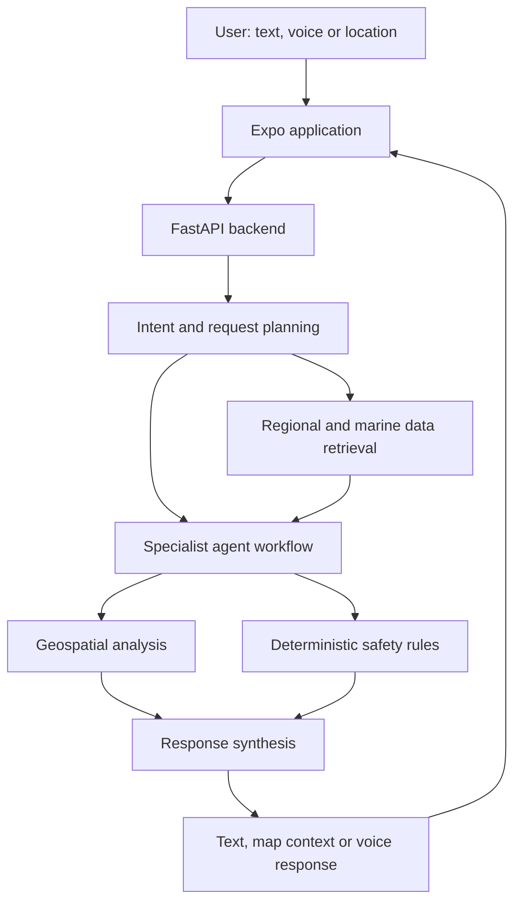

<!--
  ORCA — Ocean Risk & Coastal Advisory
  Repository landing page.
  Keep feature claims aligned with the implementation and documented data sources.
-->

<div align="center">

  

  <h1>🌊 ORCA</h1>
  <h3>Ocean Risk &amp; Coastal Advisory</h3>

  <p><strong>Marine intelligence. Safer decisions. More accessible information.</strong></p>

  <p>
    An AI-assisted maritime information platform combining marine data retrieval,
    rule-based risk assessment, geospatial utilities and multilingual interaction.
  </p>

  <p>
    <a href="https://orca-mobile-application.vercel.app"><strong>Open Live Application</strong></a>
    ·
    <a href="https://github.com/Suryaakhilp18/ORCA_MOBILE_APP">Source Code</a>
    ·
    <a href="DOCUMENTATION.md">Technical Documentation</a>
  </p>

  <p>
    
    
    
    
    
  </p>

</div>

---

## At a glance

ORCA (Ocean Risk & Coastal Advisory) is built to make maritime information easier to access and interpret. It brings together a mobile-first interface, a FastAPI service, a multi-agent query workflow, geospatial utilities and a separate deterministic rules module for configured marine-condition assessments.

The project is focused on coastal users and maritime information workflows. It is an informational and decision-support application—not a certified navigation system or an official source of maritime warnings.

<div align="center">

| 🧭 Navigation support | 🌦️ Marine context | 🤖 Agent workflow | 🎙️ Voice interaction |
|:---:|:---:|:---:|:---:|
| Route and spatial utilities | Available environmental data | Specialized processing roles | Speech-enabled experience |

</div>

## What ORCA brings together

<table>
  <tr>
    <td width="50%">
      <h3>🌊 Marine situation &amp; alerts</h3>
      Regional situation views and alert information surfaced through the application and backend APIs.
    </td>
    <td width="50%">
      <h3>🛟 Rule-based risk assessment</h3>
      Configured environmental inputs are evaluated by deterministic backend rules, separate from generative response writing.
    </td>
  </tr>
  <tr>
    <td width="50%">
      <h3>🗺️ Geospatial navigation utilities</h3>
      Location, distance, bearing and route-related utilities support maritime query context and map presentation.
    </td>
    <td width="50%">
      <h3>🎣 Ocean &amp; fishing context</h3>
      Oceanographic indicators and regional context can be used to provide indicative fishing-related information where data is available.
    </td>
  </tr>
  <tr>
    <td width="50%">
      <h3>🗣️ Multilingual voice experience</h3>
      Voice-related services and language-aware interaction support a more accessible conversational workflow.
    </td>
    <td width="50%">
      <h3>📡 Resilient application experience</h3>
      Local reference data and fallback states help the interface remain useful when some network services are unavailable.
    </td>
  </tr>
</table>

## How the system works

The application passes a user's request through an API and orchestration workflow. Relevant data and specialist processing are combined before the application presents a response.



### Specialized agent roles

The orchestration layer is organized around these documented responsibilities:

| Role | Responsibility |
|---|---|
| Planner | Interprets the request and identifies the information needed. |
| Data discovery | Locates relevant regional and source data. |
| Weather intelligence | Handles available marine-weather context. |
| Ocean analytics | Processes oceanographic and fishing-related indicators. |
| Geospatial & risk | Handles spatial calculations and route-related context. |
| Fleet operations | Handles vessel-related context when supported data is available. |
| Synthesizer | Combines results into a user-facing response. |

### Safety logic is separate from generated language

The backend includes a rules module for configured marine-condition checks. The conversational model can explain a result, but should not be treated as the authority that establishes a safety verdict.

A result is only as reliable as its input data, source freshness, geographic coverage and configured thresholds. Missing or stale observations must not be interpreted as safe conditions.

## Technology

The versions below are taken from the repository's current dependency configuration where pinned.

| Layer | Technology |
|---|---|
| Mobile and web client | Expo SDK 54, React Native 0.81.5, React 19.1 |
| Application language | TypeScript 5.9 |
| Navigation | Expo Router 6 |
| Backend API | Python, FastAPI, Uvicorn, Pydantic |
| AI integration | Google Generative AI SDK; orchestration services |
| Data and HTTP | HTTPX, Requests |
| Persistence integration | MongoDB drivers (Motor / PyMongo) |
| Voice and audio | Expo Audio, backend voice service |
| Maps and visualization | MapLibre assets, React Native SVG, geospatial utilities |
| Hosting configuration | Vercel |

External data providers and model services may require separate credentials and can have their own availability, quota and licensing conditions.

## Repository layout

```text
ORCA_MOBILE_APP/
├── api/                         # Vercel API entry point
├── backend/
│   ├── data_adapters/           # Marine and regional data adapters
│   ├── gis/                     # Spatial calculations
│   ├── notifications/           # Alert and notification services
│   ├── orchestrator/            # Agent workflow and safety rules
│   ├── voice/                   # Voice service
│   ├── server.py                # FastAPI application
│   └── tests/                   # Backend tests
├── frontend/
│   ├── app/                     # Expo Router screens
│   ├── assets/                  # Images, fonts and map assets
│   └── src/
│       ├── components/          # Reusable UI components
│       ├── context/             # Application state
│       ├── hooks/               # Reusable hooks
│       ├── utils/               # Client utilities and storage
│       └── api.ts               # API client
├── documentation/               # Project report assets
├── DOCUMENTATION.md             # Detailed project documentation
├── requirements.txt             # Python dependencies
├── vercel.json                  # Deployment routing
└── README.md
```

## Run locally

### Prerequisites

- Git
- Node.js and npm (or the package manager indicated by the frontend lockfile)
- Python and pip
- API credentials for any external services you intend to use

### 1. Clone the repository

```bash
git clone https://github.com/Suryaakhilp18/ORCA_MOBILE_APP.git
cd ORCA_MOBILE_APP
```

### 2. Configure the backend

Install the Python dependencies from the repository root:

```bash
python -m venv .venv
```

Activate the environment:

**Windows PowerShell**
```powershell
.\.venv\Scripts\Activate.ps1
```

**macOS / Linux**
```bash
source .venv/bin/activate
```

Install dependencies:

```bash
pip install -r requirements.txt
```

The FastAPI application is defined in `backend/server.py` and imported by `api/index.py` for the deployment entry point. For local development, start the application using the server module:

```bash
uvicorn backend.server:app --reload
```

If the local import path in your environment requires running from the backend directory, use:

```bash
cd backend
uvicorn server:app --reload
```

Open the API documentation at `http://127.0.0.1:8000/docs` when the server is running.

### 3. Configure the frontend

In a second terminal:

```bash
cd frontend
npm install
npm run web
```

For a device or emulator, use the corresponding Expo script:

```bash
npm run android
# or
npm run ios
```

### 4. Environment configuration

Check the backend and frontend source for the environment variables required by the integrations you enable. Common integrations in this repository include Google Generative AI and voice services.

- Keep secrets in local environment files or deployment environment settings.
- Never commit API keys, access tokens or private credentials.
- Do not place server-side secrets in variables bundled into the client.
- Provide safe fallback behaviour when an external provider is unavailable.

> **Configuration note:** Exact variable names and required values should be confirmed from the current source before deployment. Do not assume that every integration is enabled in every environment.

## API surface

The backend exposes endpoints for health, regional information, chat, marine situation, alerts, voice and saved locations. The exact request and response schemas are maintained by the FastAPI implementation.

| Method | Route | Purpose |
|---|---|---|
| `GET` | `/api/health` | Service health check |
| `GET` | `/api/regions` | Regional registry |
| `GET` | `/api/regions/detect` | Region detection |
| `POST` | `/api/chat` | Conversational request |
| `GET` | `/api/situation` | Regional marine situation |
| `GET` | `/api/alerts` | Alert retrieval |
| `GET` | `/api/alerts/stream` | Alert event stream |
| `POST` | `/api/voice/speak` | Speech generation |
| `POST` | `/api/voice/transcribe` | Audio transcription |
| `GET` / `POST` | `/api/locations` | Saved locations |
| `DELETE` | `/api/locations/{id}` | Remove a saved location |
| `GET` | `/api/geocode` | Geocoding lookup |

For the authoritative route definitions and schemas, use the running API's Swagger UI at `/docs`.

## Testing

Backend test modules are located in `backend/tests/`. The repository also includes test reports and a test-state record.

Run the backend tests from the repository root:

```bash
pytest backend/tests
```

Run frontend linting from the frontend directory:

```bash
cd frontend
npm run lint
```

Test results depend on the current code, dependencies, environment variables and external service availability. Run the checks locally or in CI before relying on a result.

## Data, safety & limitations

ORCA is a decision-support and information interface. It is not a certified navigation instrument, vessel traffic service, emergency communication system or official warning authority.

- Verify marine conditions with current official bulletins and competent authorities.
- Treat cached, mock, unavailable or stale data as unknown—not as evidence of safe conditions.
- Validate routes against authoritative nautical charts, depth information, traffic schemes and local restrictions.
- AI-generated explanations can be incomplete or incorrect.
- Fishing indicators are estimates and do not guarantee catch outcomes.
- Offline functionality does not provide live observations or live warnings.

For operational decisions, consult official sources such as the India Meteorological Department (IMD), Indian National Centre for Ocean Information Services (INCOIS), port authorities and applicable maritime agencies.

## Project documentation

- [Detailed project documentation](DOCUMENTATION.md)
- [Backend implementation](backend/)
- [Frontend implementation](frontend/)
- [Test modules](backend/tests/)

## Contributing

Contributions and technical feedback are welcome.

1. Fork the repository.
2. Create a focused feature branch.
3. Keep changes scoped and documented.
4. Run relevant tests and lint checks.
5. Open a pull request describing the change and its verification.

## License

No license is declared in this README. Review the repository's licensing terms before reusing, modifying or distributing the project.

---

<div align="center">

  <h3>🌊 ORCA — Intelligence for Safer Seas</h3>
  <p>Building more accessible maritime information experiences through software, data and AI.</p>
  <p><a href="https://github.com/Suryaakhilp18/ORCA_MOBILE_APP">View ORCA on GitHub</a></p>

</div>
