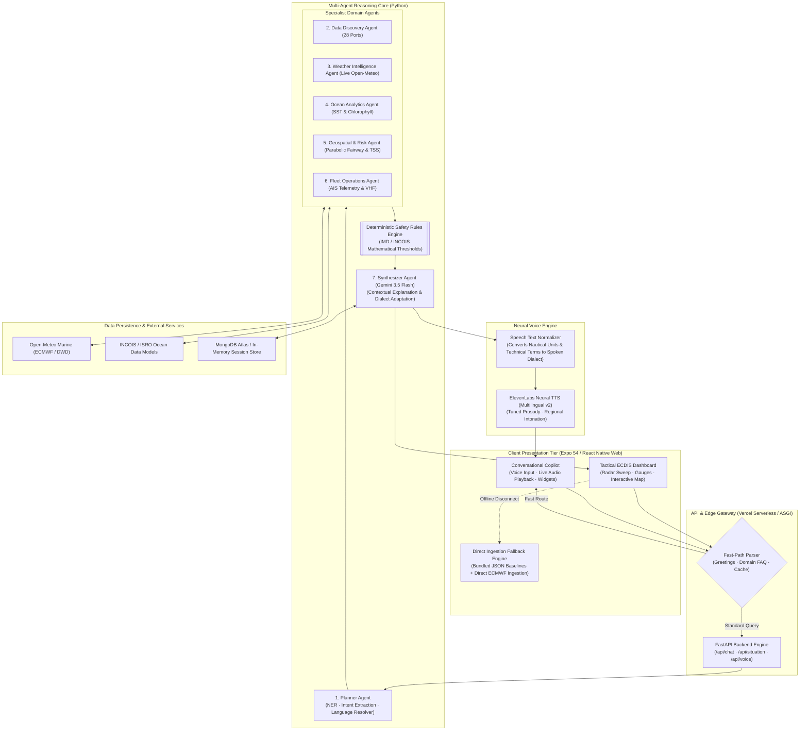

# 🌊 ORCA — Ocean Risk & Coastal Advisory
### Autonomous Marine Copilot, Tactical ECDIS Fairway Navigation & India-Wide Coastal Intelligence System

[](https://orca-mobile-application.vercel.app/)
[](LICENSE)
[](https://expo.dev/)
[](https://fastapi.tiangolo.com/)
[](https://aistudio.google.com/)
[](https://elevenlabs.io/)
[](backend/tests/)

---

## 📌 Quick Links

* **Live Web Application:** [https://orca-mobile-application.vercel.app](https://orca-mobile-application.vercel.app)
* **GitHub Repository:** [https://github.com/Suryaakhilp18/ORCA_MOBILE_APP](https://github.com/Suryaakhilp18/ORCA_MOBILE_APP)
* **Lead Architect & Developer:** **P. Surya Akhil** (`25B11CS717`)

---

## 📋 Table of Contents

1. [Executive Summary & Problem Statement](#-executive-summary--problem-statement)
2. [System Architecture & Dataflow](#-system-architecture--dataflow)
3. [Implemented Core Capabilities](#-implemented-core-capabilities)
   - [Deterministic Marine Safety Framework](#1-deterministic-marine-safety-framework)
   - [Autonomous 7-Agent Pipeline](#2-autonomous-7-agent-pipeline)
   - [Tactical ECDIS Fairway Navigation & GIS](#3-tactical-ecdis-fairway-navigation--gis)
   - [Potential Fishing Zones (PFZ) Advisory Engine](#4-potential-fishing-zones-pfz-advisory-engine)
   - [Multilingual Voice Copilot & Speech Processing](#5-multilingual-voice-copilot--speech-processing)
   - [Zero-Failure Offline Resilience](#6-zero-failure-offline-resilience)
4. [India-Wide Coastal Registry (28 Monitored Ports)](#-india-wide-coastal-registry-28-monitored-ports)
5. [Technology Stack](#-technology-stack)
6. [Repository Structure](#-repository-structure)
7. [REST & Streaming API Reference](#-rest--streaming-api-reference)
8. [Local Installation & Setup Guide](#-local-installation--setup-guide)
9. [Verification & Test Automation](#-verification--test-automation)
10. [Future Scope & Development Roadmap](#-future-scope--development-roadmap)
11. [License & Attribution](#-license--attribution)

---

## 🌊 Executive Summary & Problem Statement

India’s **7,516 km coastline** is home to over **4.5 million artisanal and mechanized fishers** and thousands of coastal vessels operating in the Bay of Bengal, Arabian Sea, and Indian Ocean. These mariners face acute operational threats:

1. **Deadly Unpredictability:** Rapidly developing cyclonic storms, squalls, and high sea states with minimal early warning.
2. **Prohibitive Language Barriers:** Most coastal weather bulletins are broadcast in formal English or standardized Hindi, leaving non-English speaking artisanal crews without actionable safety guidance.
3. **Severe Connectivity Constraints:** Marine cellular coverage degrades rapidly 10–15 nautical miles from the shoreline, causing conventional web applications to freeze or display blank screens.
4. **Dangerous Euclidean Routing:** Standard consumer navigation apps compute straight-line paths that intersect headlands, shoals, and Marine Protected Areas (MPAs).

**ORCA (Ocean Risk & Coastal Advisory)** resolves these challenges by bridging physical oceanography with agentic AI:

* **Zero-Hallucination Safety:** Safety verdicts (`SAFE`, `CAUTION`, `UNSAFE`) are calculated deterministically by an audited rule engine enforcing official **IMD** and **INCOIS** thresholds before any language model generates advice.
* **Natural Conversational Voice:** Supports voice interaction with automatic language detection, spoken dialect normalizers, and ElevenLabs neural audio synthesis with custom prosody tuning.
* **ECDIS Seaward Routing:** Generates open-sea fairway corridors with mandatory seaward clearance around rocky promontories and compliance with the **Kanyakumari Traffic Separation Scheme (TSS)**.
* **Dual-Tier Resilient Offline Architecture:** If connectivity drops or backend servers are unreachable, the client runs on bundled marine datasets and direct browser CORS requests to weather feeds.

---

## 🏛️ System Architecture & Dataflow

ORCA enforces a strict separation between **deterministic safety verification**, **spatial GIS computation**, and **generative multi-agent reasoning**:



---

## ⚙️ Implemented Core Capabilities

### 1. Deterministic Marine Safety Framework
Safety verdicts are never left to generative LLM discretion. The deterministic rules engine (`backend/orchestrator/rules.py`) evaluates parameters against official IMD and INCOIS thresholds:

$$\text{Verdict} = \begin{cases} 
\mathbf{UNSAFE} & \text{if } \text{Cyclone Warning} = \text{True} \\
                & \text{OR } v_{\text{wind}} > 25\text{ kn} \\
                & \text{OR } h_{\text{wave}} > 2.5\text{ m} \\
                & \text{OR } p_{\text{lightning}} \ge 70\% \\[6pt]
\mathbf{CAUTION} & \text{if } v_{\text{wind}} \in [18, 25]\text{ kn} \\
                & \text{OR } h_{\text{wave}} \in [1.8, 2.5]\text{ m} \\
                & \text{OR } p_{\text{lightning}} \in [40, 69]\% \\[6pt]
\mathbf{SAFE}   & \text{otherwise}
\end{cases}$$

Every verdict is returned with clear physical reasons (e.g., *"Wind speed 28 kn exceeds safe artisanal limit (25 kn)"*) and official citations.

### 2. Autonomous 7-Agent Pipeline
User requests are decomposed into specialized subtasks orchestrated by `backend/orchestrator/agents.py`:
1. **Planner Agent:** Extracts geographic entities, temporal scope (`today`/`tomorrow`), maritime intent (`route_navigation`, `pfz_nearest`, `safety_sail`, `conditions`), and language.
2. **Data Discovery Agent:** Queries the 28-port coastal database for local bathymetry, tidal datums, and pilot station coordinates.
3. **Weather Intelligence Agent:** Ingests live ECMWF and DWD marine telemetry (wind velocity, wind gusts, wave height, swell period, direction).
4. **Ocean Analytics Agent:** Evaluates satellite ocean color and thermal gradients to pinpoint biological convergence zones.
5. **Geospatial & Risk Agent:** Calculates collision-free seaward paths and verifies separation boundaries.
6. **Fleet Operations Agent:** Manages real-time AIS targets (trawlers, cargo vessels, patrol vessels) with callsigns, speeds, headings, and VHF channels (16/68).
7. **Synthesizer Agent:** Uses Google Gemini 3.5 Flash to synthesize domain data into clear, compassionate advisory text in the user's language.

### 3. Tactical ECDIS Fairway Navigation & GIS
Conventional routing fails at sea because straight lines cut through coastlines. ORCA’s GIS engine (`backend/gis/spatial.py` and `frontend/src/utils/navigation.ts`) provides genuine maritime navigation:
* **Parabolic Seaward Offsets:** Generates waypoints curving out into deep water, maintaining safe distance from rocky coastlines and shallow sandbars.
* **Cape Comorin / Kanyakumari TSS Evasion:** Enforces mandatory separation around southern India ($8.0^\circ\text{N}$ to $7.8^\circ\text{N}$), ensuring ships sailing between the Bay of Bengal and Arabian Sea round Cape Comorin safely.
* **Marine Protected Area (MPA) Avoidance:** Flags routes intersecting restricted zones (Gulf of Mannar, Gahirmatha Sanctuary).
* **Nautical Statistics:** Displays accurate open-sea distance (NM), true bearing ($\text{deg}$), compass cardinal ($^\circ\text{Cardinal}$), and estimated transit time at standard trawler cruising speeds ($8.5\text{ kn}$).

### 4. Potential Fishing Zones (PFZ) Advisory Engine
Identifies high-probability fishing grounds through oceanic front detection:
* **Thermal Frontiers:** Tracks sea surface temperatures between $27.5^\circ\text{C}$ and $29.2^\circ\text{C}$.
* **Chlorophyll-a Biomass:** Scans for phytoplankton densities exceeding $1.5\text{ mg/m}^3$.
* **Target Species & Catch Confidence:** Returns expected species (Indian Mackerel, Sardine, Yellowfin Tuna, Seer Fish) with catch probability ($80\text{--}92\%$), depth ($m$), and distance from port.

### 5. Multilingual Voice Copilot & Speech Processing
Engineered specifically for low-literacy fishers operating in noisy coastal environments:
* **Active Languages:** End-to-end voice and text processing in **Telugu (తెలుగు)**, **Hindi (हिन्दी)**, and **English (EN)**.
* **Automatic Language Identification:** Automatically identifies spoken or typed language and responds in the exact same language without manual settings toggles.
* **Spoken Dialect Sanitization (`cleanTextForSpeech`):** Converts technical abbreviations and written jargon into smooth, natural spoken phrases (e.g., converts `NM` to *"నాటికల్ మైళ్ళు"*, `kn` to *"నాట్ల వేగం"*, and replaces stiff formal phrasing with respectful colloquial maritime Telugu).
* **Tuned Neural Prosody:** Integrates ElevenLabs `eleven_multilingual_v2` with fine-tuned stability (`0.42`) and similarity boost (`0.75`), removing robotic cadence in Indic scripts.

### 6. Zero-Failure Offline Resilience
Vessels operating offshore cannot depend on uninterrupted internet:
* **Direct Browser Ingestion:** If the FastAPI backend is unreachable, the client fetches live telemetry directly from public CORS-enabled Open-Meteo endpoints in $< 300\text{ ms}$.
* **Bundled Static Baselines:** Comprehensive local datasets (`situations.json`, `alerts.json`, `mockData.json`) are bundled into the app binary so all dashboard tabs display valid information in full airplane mode.
* **Defensive Null-Guards:** Zero screen crashes or unmounting errors from missing network keys.

---

## 📍 India-Wide Coastal Registry (28 Monitored Ports)

ORCA monitors 28 verified maritime stations spanning all 9 coastal states and 2 island Union Territories:

| Port / Harbor | State / UT | Coordinates (Lat, Lon) | Primary Sea Body |
| :--- | :--- | :--- | :--- |
| **Kakinada** | Andhra Pradesh | $16.9891^\circ\text{N},\, 82.2475^\circ\text{E}$ | Bay of Bengal |
| **Visakhapatnam** | Andhra Pradesh | $17.6868^\circ\text{N},\, 83.2185^\circ\text{E}$ | Bay of Bengal |
| **Machilipatnam** | Andhra Pradesh | $16.1875^\circ\text{N},\, 81.1389^\circ\text{E}$ | Bay of Bengal |
| **Chennai** | Tamil Nadu | $13.0827^\circ\text{N},\, 80.2707^\circ\text{E}$ | Bay of Bengal |
| **Tuticorin (Thoothukudi)** | Tamil Nadu | $8.7642^\circ\text{N},\, 78.1348^\circ\text{E}$ | Gulf of Mannar |
| **Rameswaram** | Tamil Nadu | $9.2876^\circ\text{N},\, 79.3129^\circ\text{E}$ | Palk Strait |
| **Kanyakumari** | Tamil Nadu | $8.0883^\circ\text{N},\, 77.5385^\circ\text{E}$ | Laccadive Sea / TSS |
| **Kochi** | Kerala | $9.9312^\circ\text{N},\, 76.2673^\circ\text{E}$ | Arabian Sea |
| **Kozhikode** | Kerala | $11.2588^\circ\text{N},\, 75.7804^\circ\text{E}$ | Arabian Sea |
| **Vizhinjam** | Kerala | $8.3813^\circ\text{N},\, 76.9922^\circ\text{E}$ | Arabian Sea |
| **Mangalore** | Karnataka | $12.9141^\circ\text{N},\, 74.8560^\circ\text{E}$ | Arabian Sea |
| **Karwar** | Karnataka | $14.8135^\circ\text{N},\, 74.1298^\circ\text{E}$ | Arabian Sea |
| **Mormugao** | Goa | $15.4126^\circ\text{N},\, 73.8057^\circ\text{E}$ | Arabian Sea |
| **Mumbai** | Maharashtra | $18.9438^\circ\text{N},\, 72.8354^\circ\text{E}$ | Arabian Sea |
| **Ratnagiri** | Maharashtra | $16.9902^\circ\text{N},\, 73.3120^\circ\text{E}$ | Arabian Sea |
| **Malvan** | Maharashtra | $16.0620^\circ\text{N},\, 73.4682^\circ\text{E}$ | Arabian Sea |
| **Veraval** | Gujarat | $20.9077^\circ\text{N},\, 70.3678^\circ\text{E}$ | Arabian Sea |
| **Porbandar** | Gujarat | $21.6417^\circ\text{N},\, 69.6293^\circ\text{E}$ | Arabian Sea |
| **Okha** | Gujarat | $22.4647^\circ\text{N},\, 69.0716^\circ\text{E}$ | Gulf of Kutch |
| **Kandla** | Gujarat | $23.0044^\circ\text{N},\, 70.2195^\circ\text{E}$ | Gulf of Kutch |
| **Paradip** | Odisha | $20.3165^\circ\text{N},\, 86.6114^\circ\text{E}$ | Bay of Bengal |
| **Puri** | Odisha | $19.8135^\circ\text{N},\, 85.8312^\circ\text{E}$ | Bay of Bengal |
| **Gopalpur** | Odisha | $19.2612^\circ\text{N},\, 84.9080^\circ\text{E}$ | Bay of Bengal |
| **Digha** | West Bengal | $21.6266^\circ\text{N},\, 87.5074^\circ\text{E}$ | Bay of Bengal |
| **Sundarbans** | West Bengal | $22.3085^\circ\text{N},\, 88.6582^\circ\text{E}$ | Sundarbans Delta |
| **Port Blair** | Andaman & Nicobar | $11.6234^\circ\text{N},\, 92.7265^\circ\text{E}$ | Andaman Sea |
| **Kavaratti** | Lakshadweep | $10.5667^\circ\text{N},\, 72.6417^\circ\text{E}$ | Arabian Sea |
| **Puducherry** | Puducherry (UT) | $11.9416^\circ\text{N},\, 79.8083^\circ\text{E}$ | Bay of Bengal |

---

## 💻 Technology Stack

| Domain | Implemented Technologies |
| :--- | :--- |
| **Frontend Platform** | React Native 0.81, Expo 54 (Expo Router v6), React 19, TypeScript 5.8 |
| **UI Design System** | Custom High-Contrast Tactical ECDIS Theme, Plus Jakarta Sans, Space Mono |
| **Marine Mapping & GIS** | Leaflet Marine Tile Engine, React Native WebView, Turf.js & Haversine Math |
| **Charts & Radar HUD** | React Native SVG, Custom Radar Sweeper, Dynamic Telemetry Polylines |
| **Backend API Engine** | Python 3.14 / 3.11, FastAPI, Uvicorn (ASGI), Starlette, Pydantic v2 |
| **AI & Multi-Agent** | Google Gemini 3.5 Flash via Google Generative AI REST APIs |
| **Voice & Speech AI** | ElevenLabs Multilingual Neural TTS (`eleven_multilingual_v2`), Web Speech API |
| **Ocean Telemetry** | Open-Meteo Marine API (ECMWF, DWD), INCOIS & ISRO Ocean Models |
| **Spatial Geocoding** | OpenStreetMap Nominatim Geocoder & Leaflet Maritime Cartography |
| **Storage & Sessions** | Resilient In-Memory LRU Store & MongoDB Motor Persistence |
| **Cloud Deployment** | Vercel Edge Serverless Functions & Static Web CDN |
| **Verification** | Pytest 8.x test suite, strict TypeScript `tsc --noEmit` validation |

---

## 📁 Repository Structure

```
Buildx-CF/
├── api/
│   └── index.py                     # Vercel Serverless entrypoint mounting FastAPI application
├── backend/
│   ├── data_adapters/
│   │   ├── live_marine.py           # Open-Meteo live marine telemetry client
│   │   └── mock_region.py           # 28-region coastal registry, bathymetry, and tide models
│   ├── emergentintegrations/
│   │   └── llm/chat.py              # Gemini 3.5 Flash chat & multilingual synthesis client
│   ├── gis/
│   │   └── spatial.py               # Haversine math, parabolic fairway routing, TSS separation
│   ├── notifications/
│   │   └── service.py               # Alert dispatching, push token management, SSE stream
│   ├── orchestrator/
│   │   ├── agents.py                # 7-Agent autonomous marine pipeline orchestration
│   │   └── rules.py                 # Deterministic IMD/INCOIS marine safety rule engine
│   ├── voice/
│   │   └── service.py               # ElevenLabs neural TTS client & audio synthesis
│   ├── tests/
│   │   ├── test_unit_rules_and_spatial.py   # 10 unit tests for safety rules & spatial geometry
│   │   └── test_api_integration.py          # 7 integration tests for FastAPI REST endpoints
│   ├── db.py                        # MongoDB client & in-memory session persistence
│   ├── requirements.txt             # Python dependencies
│   └── server.py                    # FastAPI application, CORS, and endpoint declarations
├── frontend/
│   ├── api/
│   │   ├── chat.js                  # Edge Serverless chat route with fairway GIS injection
│   │   └── speak.js                 # Edge Serverless ElevenLabs TTS proxy
│   ├── app/
│   │   ├── (tabs)/
│   │   │   ├── alerts.tsx           # Marine Situation & Hazard Intelligence Center
│   │   │   ├── home.tsx             # Tactical ECDIS Dashboard & Telemetry Gauges
│   │   │   ├── index.tsx            # Conversational Marine Copilot (AI Chat & Voice)
│   │   │   ├── saved.tsx            # Saved Waypoints & Geofence Perimeter Manager
│   │   │   └── _layout.tsx          # Tab bar navigation, custom icons, and theme integration
│   │   └── _layout.tsx              # Root Expo Router layout with AppContextProvider
│   ├── src/
│   │   ├── components/
│   │   │   ├── AlertCard.tsx        # Danger/Warning/Advisory card with safe date formatting
│   │   │   ├── ChartWidget.tsx      # SVG line charts for SST, Wave, and Wind trends
│   │   │   ├── LanguagePicker.tsx   # Language selector modal
│   │   │   ├── MapWidget.tsx        # Interactive Leaflet marine map with fairway routes
│   │   │   ├── RadarCard.tsx        # Animated ECDIS radar sweep with live telemetry HUD
│   │   │   ├── SituationCard.tsx    # Marine situation overview card with cyclone banners
│   │   │   └── VerdictBadge.tsx     # Color-coded SAFE / CAUTION / UNSAFE indicators
│   │   ├── context/
│   │   │   └── AppContext.tsx       # Global application state (theme, region, language, user)
│   │   ├── hooks/
│   │   │   └── useVoiceAgent.ts     # Voice recording, audio stream playback, speech cleanup
│   │   ├── utils/
│   │   │   └── navigation.ts        # Client-side fairway GIS, TSS routing, port registry
│   │   ├── alerts.json              # Bundled regional hazard & alert bulletins
│   │   ├── api.ts                   # Robust API client with auto-switch fallback
│   │   ├── i18n.ts                  # Localization dictionary
│   │   ├── mockData.json            # Fallback marine telemetry for all 28 ports
│   │   ├── situations.json          # Bundled situation reports and ocean trend series
│   │   └── theme.ts                 # Dual dark/light theme tokens and ECDIS styling
│   ├── package.json                 # Node dependencies and build scripts
│   └── tsconfig.json                # Strict TypeScript configuration
└── README.md                        # Master project documentation
```

---

## 📡 REST & Streaming API Reference

The FastAPI backend exposes clean REST endpoints and real-time Server-Sent Events (SSE):

| Method | Endpoint | Parameters / Payload | Description |
| :--- | :--- | :--- | :--- |
| `GET` | `/api/health` | None | Service health check, database status, and UTC timestamp. |
| `GET` | `/api/regions` | None | Returns list of all 28 monitored coastal ports with coordinates. |
| `GET` | `/api/regions/detect` | `lat={float}&lon={float}` | Resolves nearest coastal port and distance ($\text{km}$) from GPS. |
| `POST` | `/api/chat` | `{"session_id": "...", "message": "...", "region_id": "kakinada", "language": "te"}` | Executes the 7-agent pipeline; returns safety verdict, answer, citations, and interactive map widgets. |
| `GET` | `/api/situation` | `region_id={id}&language={lang}` | Returns consolidated marine advisory, 7-day trend series, tide events, and active warnings. |
| `GET` | `/api/alerts` | `region_id={id}&language={lang}` | Retrieves localized cyclone and squall bulletins from IMD / INCOIS. |
| `GET` | `/api/alerts/stream` | `region_id={id}` | Real-time Server-Sent Events (SSE) stream for instant storm broadcast delivery. |
| `POST` | `/api/voice/speak` | `{"text": "...", "language": "te"}` | Streams high-fidelity `audio/mpeg` speech synthesized with natural Indic prosody. |
| `POST` | `/api/voice/transcribe` | Multipart audio file (`audio/m4a`, `audio/wav`) | Transcribes spoken audio into text with automatic language detection. |
| `GET` | `/api/locations` | `user_id={id}` | Returns user’s bookmarked nautical waypoints and tracked vessels. |
| `POST` | `/api/locations` | `{"name": "...", "lat": 16.98, "lon": 82.25, "user_id": "...", "is_vessel": false}` | Saves location and evaluates geofence proximity against active hazard zones. |
| `DELETE` | `/api/locations/{id}` | None | Removes saved waypoint. |
| `GET` | `/api/geocode` | `q={search_string}` | Geocodes coastal locations via Nominatim with local caching. |

---

## 🛠️ Local Installation & Setup Guide

### Prerequisites
* **Python** 3.10 through 3.14
* **Node.js** 18.x or 20.x and **npm**
* **Git**

### 1. Clone the Repository
```bash
git clone https://github.com/Suryaakhilp18/ORCA_MOBILE_APP.git
cd ORCA_MOBILE_APP
```

### 2. Configure Environment Variables
Create a `.env` file in the project root or `backend/` directory:
```env
GEMINI_API_KEY=your_gemini_api_key_here
ELEVENLABS_API_KEY=your_elevenlabs_api_key_here
PORT=8000
```
*(Note: If API keys are omitted, ORCA operates in local resilient mode using deterministic rules and bundled voice synthesis).*

### 3. Run Backend (FastAPI Monolith)
```bash
cd backend
python -m pip install -r requirements.txt
python -m uvicorn server:app --host 127.0.0.1 --port 8000 --reload
```
* **Swagger API Documentation:** Open `http://127.0.0.1:8000/docs` in your browser.

### 4. Run Frontend (Expo Web Client)
In a separate terminal:
```bash
cd frontend
npm install
npx expo start --web --port 8081
```
* Open your browser at: `http://localhost:8081`

---

## 🧪 Verification & Test Automation

ORCA maintains comprehensive test suites covering mathematical boundary rules, geospatial routing, and REST API integration.

### Run Python Test Suite:
```bash
cd backend
python -m pytest -o addopts="" tests/test_unit_rules_and_spatial.py tests/test_api_integration.py -v
```

```
============================== test session starts ==============================
collected 17 items

backend/tests/test_unit_rules_and_spatial.py::TestSafetyRules::test_safe_conditions PASSED          [  5%]
backend/tests/test_unit_rules_and_spatial.py::TestSafetyRules::test_caution_moderate_waves PASSED  [ 11%]
backend/tests/test_unit_rules_and_spatial.py::TestSafetyRules::test_unsafe_cyclone_warning PASSED  [ 17%]
backend/tests/test_unit_rules_and_spatial.py::TestSafetyRules::test_unsafe_high_lightning PASSED   [ 23%]
backend/tests/test_unit_rules_and_spatial.py::TestSafetyRules::test_situation_severity PASSED     [ 29%]
backend/tests/test_unit_rules_and_spatial.py::TestSpatialAlgorithms::test_haversine_distance PASSED [ 35%]
backend/tests/test_unit_rules_and_spatial.py::TestSpatialAlgorithms::test_bearing_cardinal PASSED [ 41%]
backend/tests/test_unit_rules_and_spatial.py::TestSpatialAlgorithms::test_point_in_polygon PASSED [ 47%]
backend/tests/test_unit_rules_and_spatial.py::TestSpatialAlgorithms::test_nearest_pfz PASSED       [ 52%]
backend/tests/test_unit_rules_and_spatial.py::TestSpatialAlgorithms::test_route_safety_navigation PASSED [ 58%]
backend/tests/test_api_integration.py::TestApiEndpoints::test_health PASSED                       [ 64%]
backend/tests/test_api_integration.py::TestApiEndpoints::test_regions_and_detect PASSED          [ 70%]
backend/tests/test_api_integration.py::TestApiEndpoints::test_situation PASSED                  [ 76%]
backend/tests/test_api_integration.py::TestApiEndpoints::test_alerts PASSED                     [ 82%]
backend/tests/test_api_integration.py::TestApiEndpoints::test_locations_crud PASSED               [ 88%]
backend/tests/test_api_integration.py::TestApiEndpoints::test_register_push_token PASSED         [ 94%]
backend/tests/test_api_integration.py::TestApiEndpoints::test_chat_pipeline PASSED               [100%]

============================== 17 passed in 10.57s ===============================
```

### Run TypeScript Verification:
```bash
cd frontend
npx tsc --noEmit
```
* **Exit code 0 — Strict type safety verified across all components and API utilities.**

---

## 🔮 Future Scope & Development Roadmap

While ORCA provides a complete, operational maritime safety and navigation system today, several high-impact capabilities are planned for upcoming development:

1. **Expanded Regional Voice AI & Dialect Models:**
   * Broaden neural voice synthesis and native speech recognition beyond the current English, Hindi, and Telugu foundations to include all coastal Indian languages: **Tamil (`ta`)**, **Malayalam (`ml`)**, **Kannada (`kn`)**, **Bengali (`bn`)**, **Marathi (`mr`)**, **Gujarati (`gu`)**, and **Odia (`or`)**.
   * Train acoustic language models on regional fishing dialects and colloquial coastal terminologies to maximize recognition accuracy on loud engine decks.
2. **On-Device / Offline Edge Voice Models:**
   * Package lightweight, on-device voice inference models (such as quantized Whisper-small and Piper TTS) directly within mobile binaries, allowing full conversational voice assistance even when completely disconnected from satellite or cellular networks.
3. **Hardware Coupling with NavIC & Satellite Receivers:**
   * Direct Bluetooth/Serial interfacing with indigenous **NavIC (IRNSS)** marine satellite receivers for centimeter-grade location precision independent of GPS.
   * Integration with two-way satellite distress communicators and low-bandwidth satellite packet transceivers (GSAT / Iridium) for emergency SOS beacons far beyond coastal coverage.
4. **Dynamic Bathymetric Depth Curves & Keel Clearance:**
   * Integrate high-resolution GEBCO and nautical chart soundings to compute dynamic keel clearance based on real-time tidal heights, warning skippers of underwater shoals during low tide.
5. **Computer Vision Catch Quality & Species Classifier:**
   * Incorporate edge AI camera models to allow fishers to photograph their catch on deck, receiving instant species verification, regulatory minimum legal size (MLS) compliance checks, and market value estimates.

---

## 👨‍💻 License & Attribution

* **Project:** ORCA (Ocean Risk & Coastal Advisory)
* **Lead Architect & Developer:** **P. Surya Akhil**
* **Roll Number:** `25B11CS717`
* **License:** Distributed under the **MIT License**. See [`LICENSE`](LICENSE) for terms.

---
*Built with dedication to maritime safety, fisher empowerment, and sustainable coastal development.* ⚓🌊
